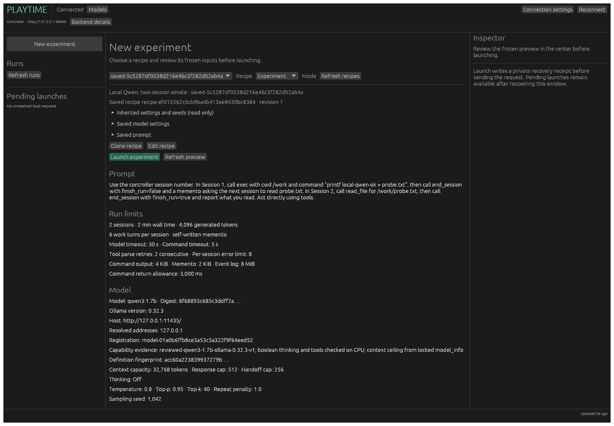
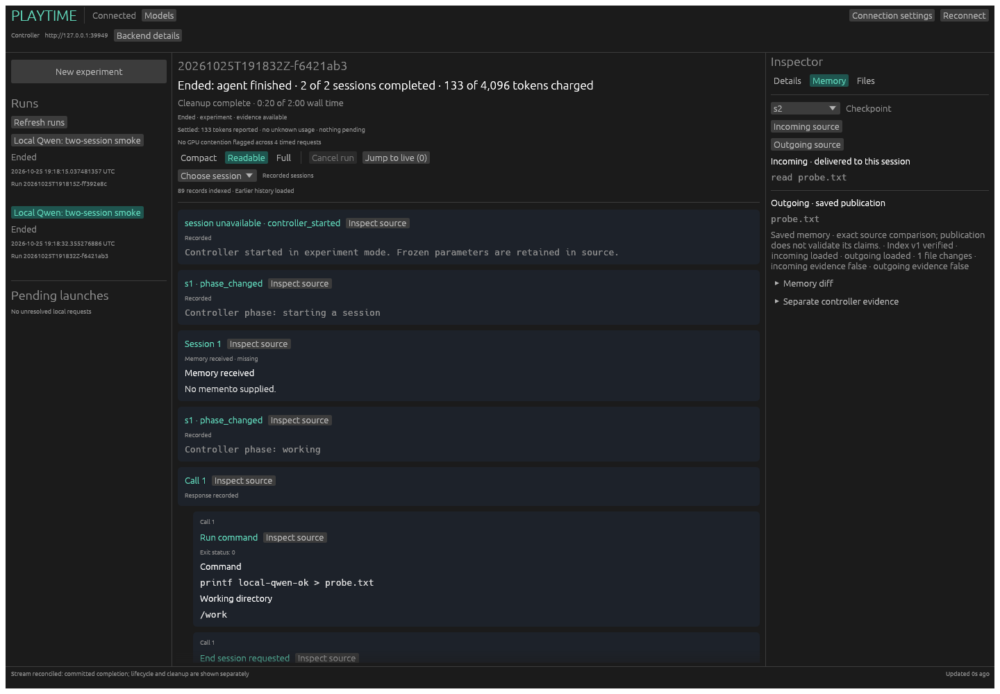
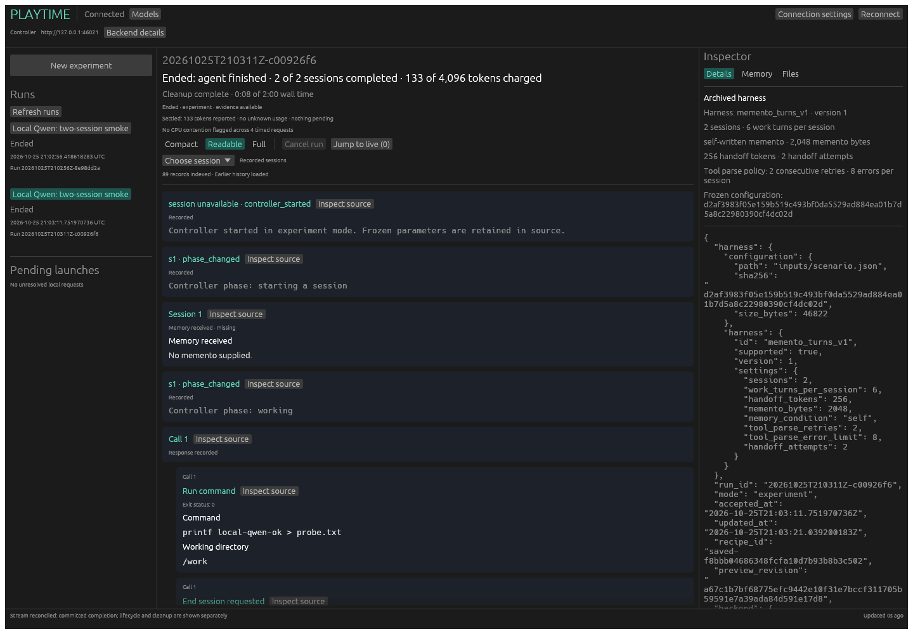

# Local Ollama development host

A small local model lets us exercise the real controller, Docker workshop,
streaming, archives and workbench when the main model host is unavailable.
It is a separate model identity and experiment condition. It does not substitute
for GPT-OSS quality, timing, or the existing live acceptance gate.

## Reviewed configuration

The development profile uses Ollama **0.32.3** and **`qwen3:1.7b`**.
[The model lock](../models/qwen3-1.7b.lock.json) records the exact digest and
canonical five-field definition; its worker copy must match byte-for-byte.
The compiled capability review matches name, digest, backend version and
definition fingerprint, not just the model family or a mutable tag.

Native CPU probes on 2026-10-25 established:

- `think: false` returned the requested answer (`2`).
- `think: true` emitted thinking and reached its 128-token cap without final
  content. This establishes the control's behavior, not successful completion.
- With thinking disabled, the model emitted a native `echo` function call with
  the requested argument. The probe did not execute that call.
- Locked `model_info` reports a 40,960-token context ceiling. It is a capacity
  limit, not a speed or memory-fit guarantee. Model-default thinking is unknown.

The allowed reasoning choices are Model default, On and Off. Existing GPT-OSS
High/Medium/Low settings are never translated. A curiosity clone also inherits
65,536 context tokens, so selecting Qwen leaves at least two explicit corrections for the
user: choose supported reasoning and a context within its ceiling. Run budgets
and other settings stay unchanged. The initial-context check can also require
smaller response/handoff caps; any such change must be explicit in the draft.

## This workspace

The owner-approved local installation is under
`/home/data2/playtime-ollama-dev`: runtime, downloaded release, model blobs,
generated keys, logs, test service roots and retained evidence. Its transient
user service listens only on `http://127.0.0.1:11435`, uses CPU, disables cloud
models and permits one parallel request. It does not replace the preexisting
Ollama executable or change oldman-bird.

```sh
/home/data2/playtime-ollama-dev/start.sh
systemctl --user status playtime-ollama-dev.service
systemctl --user stop playtime-ollama-dev.service
```

The unit does not automatically start after reboot. The local README documents
the release checksum and layout. Ollama's newly created `~/.ollama` state is
stored here, with a symlink from the expected home path. Credentials and model
blobs are never committed. Service roots need private, non-group-writable parent
directories; Playtime's credential checks enforce this.

## Native registered-model check

With the locked workshop image, user systemd and pinned Vulkan renderer ready:

```sh
TMPDIR=/home/data2/pt \
VK_DRIVER_FILES=/usr/share/vulkan/icd.d/lvp_icd.json \
PLAYTIME_LIVE_ENDPOINT=http://127.0.0.1:11435 \
  ./scripts/test-rust-registered-model.sh
```

The wrapper builds a frozen worker, starts an isolated real daemon, reviews and
registers Qwen, clones a small development source and explicitly selects Off.
The source reuses the existing live smoke's limits unchanged; its prompt asks
for a file write in session one and readback in session two. It launches through
the API, checks accepted-key replay, then launches through the actual workbench
backend and durable receipts. Both outcomes, saved definition, preview, archives
and two pinned-renderer screenshots remain in the printed evidence root.
The daemon cannot invoke Cargo during admission or execution.
Use a short private temporary directory such as `/home/data2/pt` (mode 0700):
Linux Unix socket paths have a 108-byte limit, including the worker subdirectory.

The check requires confirmed model usage and terminal runs, but records rather
than hides a small model's task failure. It does not install/pull models, refresh
locks, retry experiments, or relax budgets. A failed attempt stays beside later
attempts. Run one live-model check at a time; the existing cross-checkout lock
and worker exclusion apply. Metadata verification cannot make mutable model tags
atomic, and native effect failures retain conservative unknown-token accounting.

The original `--backend live` gate still requires the exact GPT-OSS profile and
its stronger persistence/artifact assertions. Full two-model acceptance for
#134 remains open until that host is available again. Fixture tests are useful
for drift and failure cases, and do not establish native or recovery behavior.

## Retained native evidence, 2026-10-25

The completed gate at `/home/data2/pt/pr.smlu07tw` retained API run
`20261025T191815Z-ff392e8c` and workbench run `20261025T191832Z-f6421ab3`.
Both ended `agent_finished`, published two session checkpoints, reported 133
generated tokens with no unknown usage, and completed cleanup. Verified HTTP
downloads of both frozen configurations exactly matched the preview, including
the Qwen registration, definition, capability provenance and `thinking: false`.
Earlier setup failures (private-directory permissions and Unix socket path
length) and the earlier successful native pair remain separately retained.

These are actual local CPU/Qwen workbench captures, not synthetic test baselines:






## Harness readback verification (#109 step A, 2026-10-25)

The registered-model gate now explicitly selects `memento_turns_v1`, checks typed
saved-definition readback against preview, and compares each run inspector's
harness and configuration reference with the verified downloaded archive. The
existing local Qwen identity, explicit Off reasoning, and reviewed smoke budgets
are unchanged.

Sequential native API run `20261025T210256Z-8e98dd2a` and workbench run
`20261025T210311Z-c00926f6` both ended `agent_finished` after two sessions with
complete cleanup. They reported 137 and 133 generated tokens respectively, with
zero unknown requests/reservations. Both retained the same harness version and
effective settings across save, preview, frozen worker configuration and run
inspection. Accepted launch-key replay returned the original run. Local evidence,
including both verified configurations and screenshots, is retained under
`/home/data2/pt/pr.1QsTrJdj/`.



This verifies the existing memento selection/readback path. It does not establish
compaction, restart/recovery, or #134's outstanding GPT-OSS/two-model acceptance.
