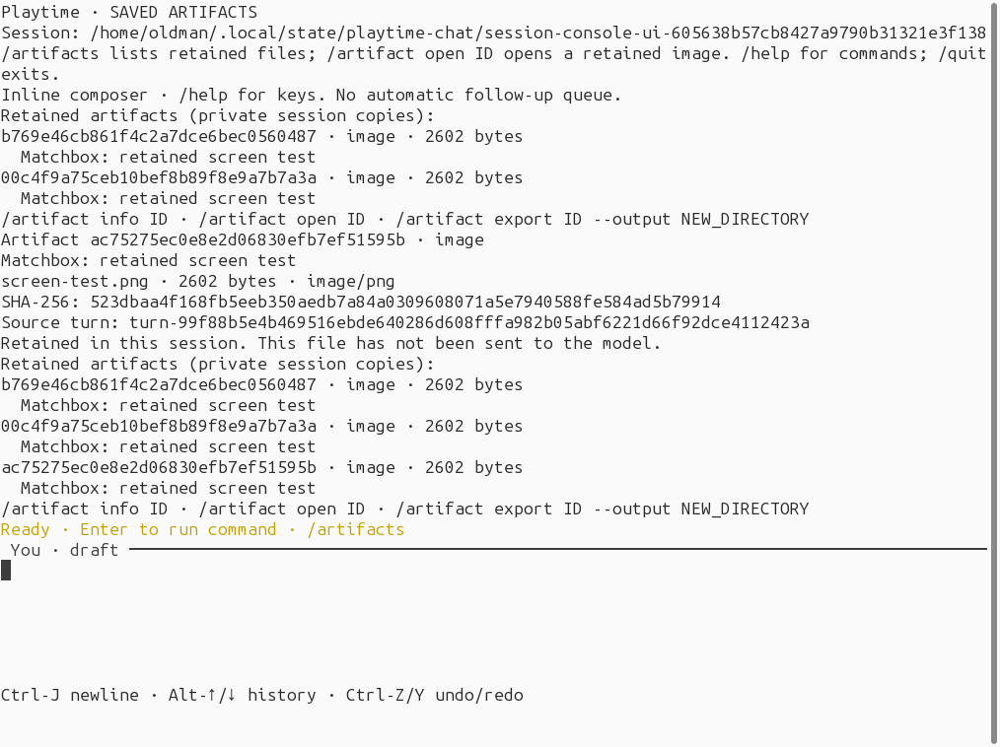
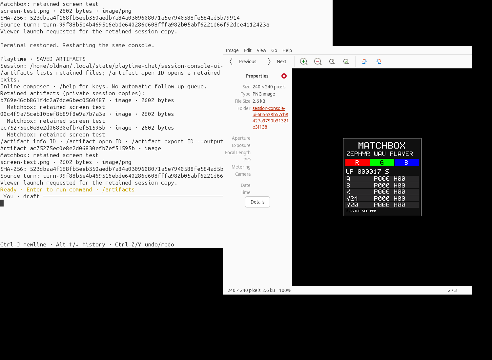

# Durable console attachments (waypoint 3)

An artifact is an explicitly retained copy of a project file, associated with the
session's most recent completed turn. It has a stable ID, kind, caption, original
basename, byte count, SHA-256 digest and retention timestamp. A diagram can retain
UTF-8 source alongside its rendered PNG/JPEG. Retention records the user's chosen
association; it does not assert that a model or tool produced the file.

In an idle interactive chat:

```text
/artifact retain "build/screen test.png" --caption "Player screen after the fix"
/artifact retain build/controller.png --caption "Controller ownership" --source docs/controller.mmd
/artifacts
/artifact info ID
/artifact open ID
/artifact export ID --output /absolute/new-export-directory
```

Quote paths with spaces. Source paths must be relative to the selected project;
parent traversal, symlinks and special files are refused. A file that changes
during the bounded read is refused. No command is run to generate or render it.
Render diagrams using the project's existing tools inside its project execution
boundary, then retain the rendered image and source. Only explicit keyboard
actions reach these operations; Markdown, model text and tool results cannot
request a viewer launch or automatic capture.

The new CLI supplies the same operations, without an endpoint, project image or
model server:

```sh
candidate="$HOME/.local/lib/playtime-chat-console-ui"
"$candidate/playtime-artifacts" --session /absolute/private/session \
  --workspace /absolute/project retain "build/screen test.png" --caption "Player screen"
"$candidate/playtime-artifacts" --session /absolute/private/session --json list
"$candidate/playtime-artifacts" --session /absolute/private/session --json info ID
"$candidate/playtime-artifacts" --session /absolute/private/session open ID
"$candidate/playtime-artifacts" --session /absolute/private/session \
  export ID --output /absolute/new-export-directory
"$candidate/playtime-console" --artifact-session /absolute/private/session
```

The saved browser supports listing, inspection, export and opening. Add
`--workspace /absolute/project` to enable explicit retention there too. It never
submits model messages. With redirected output, `TERM=dumb`, or `--plain`, it
prints the catalog and exits; `--plain --json` emits the artifact API response.
The standalone `playtime-artifacts` command also works from a plain chat terminal.
Its `artifact_api_version: 1` response is distinct from runtime event envelopes.

## Retention and storage

The harness stores `artifacts-v1.json` and generated `artifact-ID.*` basenames in
the existing private session directory, outside the project tool root. Protocol
types live in `playtime-protocol::artifacts`; storage and offline session admission
live in `playtime-harness::artifacts`; command parsing, bounded project reads,
image validation, export and desktop launching live in `playtime-chat::artifacts`.
Both clients call those APIs. File I/O and decoding run outside terminal rendering.

Retention requires exclusive mutable access to a ready `Session`, its existing
process lease, and a completed checkpoint. Offline retention refuses a live lease
or an unfinished turn. Reads do not acquire that lease: previously retained
artifacts remain inspectable even when another turn is active or fenced. No
artifact read resumes work or replays effects. Recovery forks leave attachments
in the retained source session; they do not silently copy or reattach them.

Limits are 128 artifacts, 16 MiB per primary file, 1 MiB per optional source,
256 MiB of artifact blobs per session, and a 512 KiB catalog. Captions allow
2 KiB of non-control text; basenames allow 255 bytes. The quota includes abandoned
artifact blobs. Images are PNG/JPEG only for opening, with decoding limits of
8192 pixels per axis and a 64 MiB allocation budget. Other nonempty regular files
can be retained and exported as opaque files; they are never launched.

Files are mode 0600 in the mode-0700 session. Blob publication precedes atomic
catalog replacement. A failed publication may leave an orphan, which consumes
quota and requires offline inspection; readers never discover or promote it.
IDs and original basenames cannot select arbitrary private paths. Info, open and
export verify stored byte counts and digests. List reads bounded metadata without
decoding every image. Existing checkpoints and model context are unchanged.

Retention lasts for the lifetime of the saved session. There is no automatic
capture, eviction, per-artifact deletion or garbage collection in this waypoint.
Export creates a **new** mode-0700 directory containing the verified copy, optional
source, and `artifact.json`, each mode 0600. Existing destinations are refused;
failed exports may leave a partial destination and are not retried automatically.
Export valuable copies before removing a saved session.

`open` launches `/usr/bin/xdg-open` with the verified private PNG/JPEG path and no
shell. It reports a viewer launch request, not confirmation that a window appeared.
The desktop helper is reaped independently of the console. Actual MATE image-viewer
behavior is checked separately below. Artifacts are not submitted to the model;
displaying an image establishes no model vision capability. Inline previews,
model attachments and transcript navigation remain later waypoints.

## Fast acceptance and MATE evidence

```sh
cargo test -p playtime-protocol --test artifacts --locked
cargo test -p playtime-harness -p playtime-chat --locked
cargo build -p playtime-chat --locked
python3 scripts/console/test_pty.py
```

The subprocess tests create real completed simulation checkpoints through the
shared controller, retain a PNG and diagram source, replace/delete the original
files, reopen metadata, and export identical copies. They check no-overwrite,
file permissions, corrupt bytes, symlinks, parent traversal, FIFOs, active leases,
unsupported opening and plain-output fallback. Harness fixtures additionally
check fenced-turn reads, unchanged checkpoints, limits, invalid catalogs and
non-promotion of orphan blobs. The additive protocol golden is synthetic metadata.
The PTY gate checks that artifact commands stay explicit and never become model
submissions. These fast tests need no Docker, model server or desktop.

For the actual installed MATE Terminal and desktop viewer, first copy a PNG into
a disposable project whose private session has a completed turn, then run:

```sh
python3 scripts/console/mate_smoke.py \
  --binary "$HOME/.local/lib/playtime-chat-console-ui/playtime-console" \
  --output /absolute/new-evidence-directory \
  --artifact-session /absolute/private/test-session \
  --workspace /absolute/disposable-project --artifact-file screen-test.png
```

This test intentionally replaces the supplied disposable `screen-test.png` after
opening its retained copy. It restarts the saved browser and opens that same ID
again, verifies its digest, checks that no model message was submitted, and checks
termios restoration twice. The private X display and clipboard isolate it from
daily terminal use. The requirements are those of the
[MATE console check](rust-console-ui.md#stack-probe-and-verification), plus
`xdg-open` and an associated PNG viewer (Eye of MATE on the tested desktop).

The [initial November 14 report](../experiments/chat-console/2026-11-14-console-artifacts.json)
records the earlier candidate binary digests and results. The
[completion report](../experiments/chat-console/2026-11-14-console-completion.json)
records the refreshed MATE checks and screenshots below against the delivery
candidate. The source image was a committed
Matchbox screenshot copied into the earlier disposable chat project; no Matchbox
build, model inference or hardware capture was performed for this check. The
saved conversation came from the earlier owned live smoke. The normal installation
was left unchanged.




