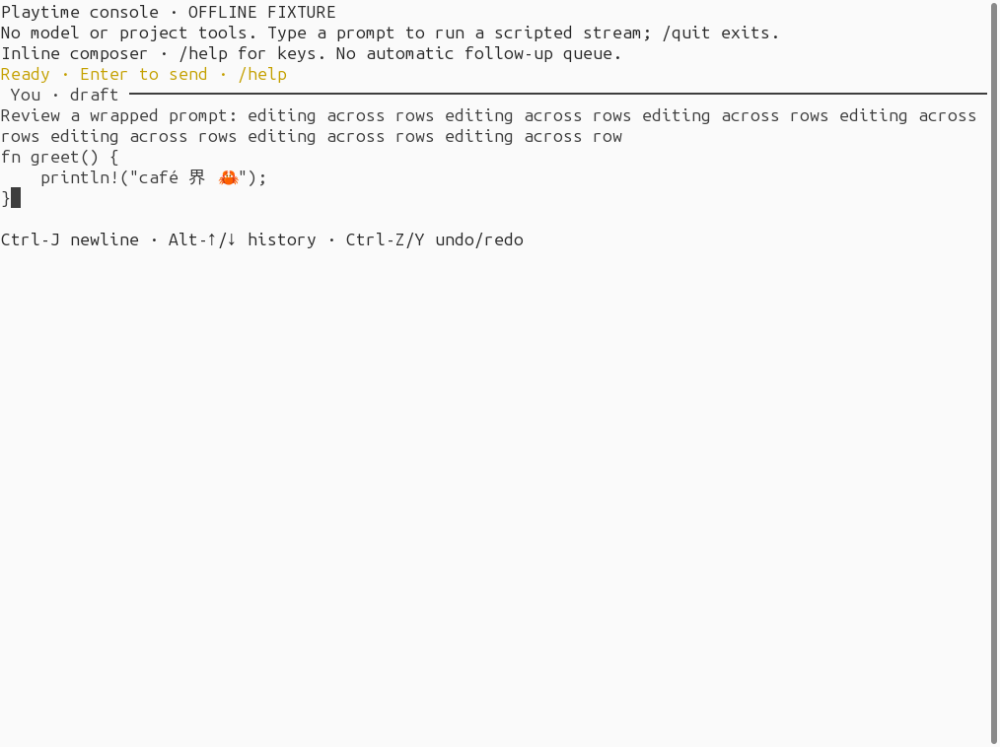
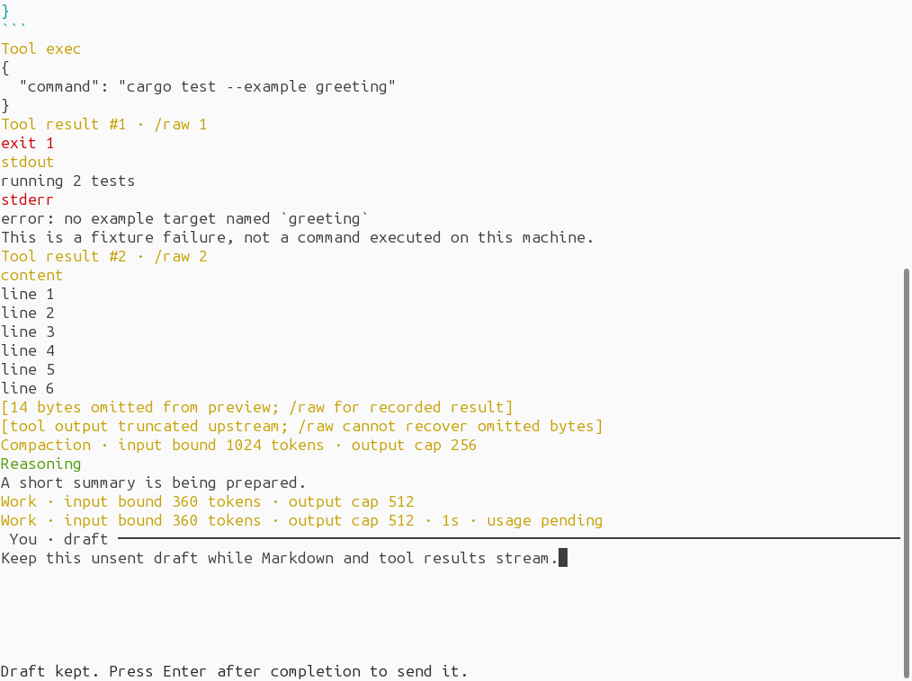
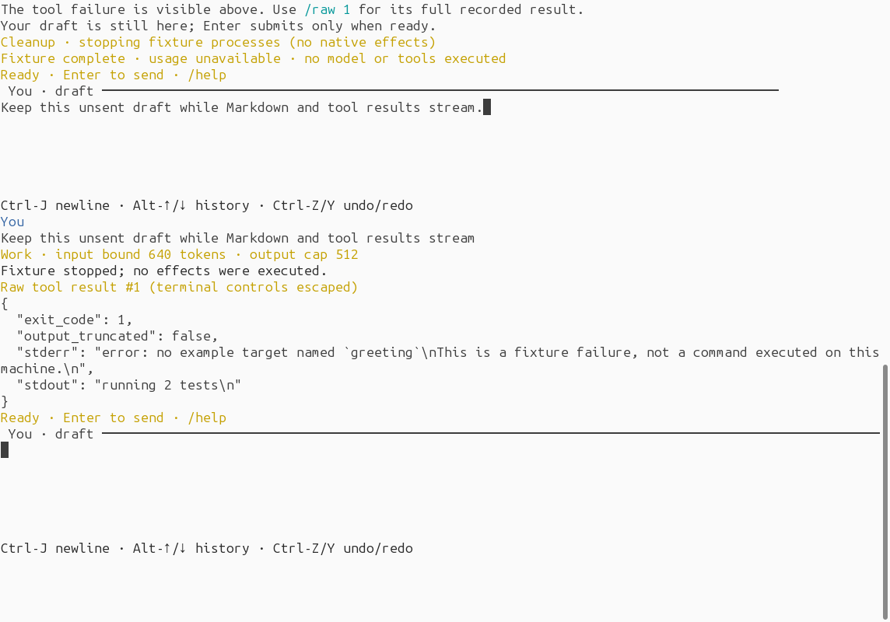

# Inline chat console: waypoints 1–3

Interactive `playtime-chat` uses an inline multiline composer over the existing
chat runtime. `--plain`, redirected input/output, and `TERM=dumb` retain the
line-oriented interface. `--prompt --json` keeps its version-1 runtime event
envelopes. The candidate installs separately from daily-use chat:

```sh
PLAYTIME_CHAT_INSTALL_DIR="$HOME/.local/lib/playtime-chat-console-ui" \
  ./scripts/install-chat-launcher.sh
~/.local/lib/playtime-chat-console-ui/playtime-console
~/.local/lib/playtime-chat-console-ui/run-strata.py framework-gyro-m-fast \
  --workspace /absolute/disposable-project
```

The first command in that installation runs an **offline presentation fixture**;
the wrapper acquires and verifies the real host. Keep the normal shared chat state
root for live project leases. Do not point candidate tests at daily project files
or replace the normal launcher entry.

## Editing and reading

| Input | Action |
| --- | --- |
| Enter | Submit when idle; preserve the draft while work runs |
| Ctrl-J or Alt-Enter | Insert a newline; no dependency on Shift-Enter reporting |
| Bracketed paste / MATE Ctrl-Shift-V | Insert multiline text without submitting it |
| Arrows, Home, End, Delete, Backspace | Edit the wrapped draft |
| Ctrl-Z / Ctrl-Y | Undo / redo |
| Alt-Up / Alt-Down | Recall submitted drafts; return to the current unsent draft |
| Ctrl-C | Stop active work and await owned cleanup; exit when idle |
| Ctrl-D with an empty draft | Exit, cancelling active work first |
| `/stop`, `/quit`, `/help` | Stop, exit, or show bindings |
| `/raw` or `/raw N` | Show the latest or numbered retained tool result |
| `/artifacts` | List the session's durable file copies |
| `/artifact retain PATH --caption "Description"` | Retain a project file after a completed turn |
| `/artifact info ID`, `/artifact open ID`, `/artifact export ID --output NEW_DIRECTORY` | Inspect, open, or export a retained file |

Drafts are limited to 64 KiB. Oversized pastes are refused atomically. History
retains at most 50 entries/512 KiB, and undo retains 64 edits. These are process-local
editing aids; saved drafts, follow-up queues and transcript navigation
remain later work. A stopped console prints its unsent draft on exit and never
submits it automatically. Interrupted real turns retain the existing session fence
and explicit recovery rules.

The renderer distinguishes user input, assistant text, available reasoning,
tools, errors and controller phases. It formats headings, emphasis, inline code,
lists, links and fenced code. Completed lines enter native terminal scrollback;
a partial line is displayed immediately and formatted once complete. Partial lines
are bounded to 4 KiB; longer lines are emitted in literal fragments with continuation
markers. This is deliberately basic Markdown: tables, multiline emphasis, syntax
highlighting and inline diagrams/images are not implemented. Retained PNG/JPEGs
open through an explicit external-viewer action. No model text can emit
terminal control sequences.

Tool previews retain six lines/700 bytes per field and label omitted bytes.
Upstream truncation has a separate marker: the console cannot recover bytes the
tool never returned. `/raw` retains up to 16 results/512 KiB, with a 128 KiB
per-result ceiling. Full recorded evidence remains in the private session files.
For an older result, the offline CLI can print one exact record without an endpoint,
image, runtime, or tool execution:

```sh
playtime-console --session /absolute/private/session \
  --record events-TURN-SEQUENCE.jsonl
```

Only private `events-*.jsonl` / `result-*.json` basenames are accepted, with an
8 MiB read limit and existing private-file/link policy. This is evidence inspection,
not saved-transcript navigation or session recovery.

The startup banner identifies the workspace, environment category, model,
endpoint, locked generation settings and context allocation. Phase status shows
elapsed UI time, input **bounds**, output **caps**, and pending usage. Final usage
comes directly from the shared runtime, including unknown charges. No token rate,
measured context occupancy, or warm-start timing is inferred. The owner wrapper
continues to report startup/warm reuse and host verification.

## Boundaries for later waypoints

`console::Composer` owns editing; `Presentation` consumes structured observations;
`Console` translates explicit `Submit`, `Stop`, `Quit`, and `Artifact` actions. One dedicated
thread owns terminal writes. An independent input reader can cancel the active
token before rendering catches up. Bounded channel overflow stops work rather
than silently dropping output and continuing project edits.
Input carries its read time: an Enter buffered behind output cannot become a
submission when a queued completion reaches the renderer first. Markdown text
is sanitized again after parsing, since character references can decode controls.

The UI receives the existing runtime events. `Stopped` does not enable submission:
only the completed runtime task can mark the composer ready after checkpoint
publication and cleanup. Output failures request cancellation, and the caller
still awaits the owned runtime task. No controller, effect policy, durable event
schema, inference ownership or project lease has moved into presentation.

`Observation` is a presentation/replay format, **not** a storage contract. Formatting
is separate from data. Native scrollback is the visible transcript for this slice;
model compaction does not clear it. A later navigable UI must load committed session
records with bounded paging, independently of the compacted model checkpoint. It
must not reconstruct authority or replay work from these transient observations.
The [artifact store](rust-console-artifacts.md) has a separate versioned catalog,
bounded copies, stable IDs, digests and explicit retention/export. Artifacts are
independent of both presentation observations and model context. The module boundary permits a
richer Ratatui viewport or another client without replacing the shared agent loop.

## Stack probe and verification

A disposable probe compared Reedline 0.49.0 (compatible with the pinned Rust
1.94 toolchain) and Ratatui 0.30.2 with ratatui-textarea 0.9.4. Both preserved the
same submitted Unicode/multiline buffer under PTY wrapping, backspace, paste,
resize and external output, and restored termios. Both were exercised in MATE
Terminal. Reedline's default Ctrl-J submits, so the production portable-newline
binding would require customization. Ratatui's existing wrapped textarea was
sufficient without implementing an editor; it also supports the later layout.
The retained `playtime-console` binary is the driveable prototype of that choice.

The production coordinator enables Crossterm scrolling regions to avoid clearing
the composer between inserted lines. It uses Crossterm's `use-dev-tty` polling
backend: the default Mio reader spun on EOF when a MATE PTY disappeared during
verification. Hangup now has a regression test. A small adapter makes horizontal
movement/deletion respect combining-character and joined-emoji graphemes.

Fast functional checks (no inference, Docker or desktop required):

```sh
cargo test -p playtime-chat --locked
cargo build -p playtime-chat --locked
python3 scripts/console/test_pty.py
# Test the installed candidate as well:
PLAYTIME_CONSOLE_BIN="$HOME/.local/lib/playtime-chat-console-ui/playtime-console" \
  python3 scripts/console/test_pty.py
# Deterministic presentation replay, with optional --json:
playtime-console --plain
playtime-console --replay crates/playtime-chat/tests/fixtures/console-v1.jsonl --autoplay
```

The offline CLI accepts bounded JSONL presentation observations. `--actions NEWFILE`
records user actions as JSONL in a new mode-0600 file, so tests can assert the exact
submitted prompt rather than infer editing correctness from escape sequences.
Replay never executes its tool descriptions. Its `console_observation_version: 1`
JSON envelope is intentionally distinct from runtime `schema_version: 1` events.

Actual MATE/VTE checks and screenshots use a separate X display and clipboard:

```sh
python3 scripts/console/mate_smoke.py \
  --binary "$HOME/.local/lib/playtime-chat-console-ui/playtime-console" \
  --output /absolute/new-evidence-directory
```

This requires MATE Terminal, Xvfb, xclip, Pillow and python3-xlib. It drives real
keyboard/paste/resize events, verifies submitted buffers and both clean exit and
restart termios, and retains PNGs, action logs and a report. It uses memory-only
settings and never changes the user's terminal profile or clipboard. Native
scrollback and resize reflow remain terminal-owned: narrowing can move the visible
transcript into scrollback and leave space below the inline composer. Application
transcript scrolling and keeping a historical reading position are waypoint 4.

The November 14 MATE check exercised the installed emulator on a private X11
display, not a claim about every terminal or a manual check in an existing daily-use
window. The screenshots below are actual fixture output, not model execution.







## Historical candidate evidence, November 14

The [recorded report](../experiments/chat-console/2026-11-14-console-ui.json)
binds the final installed binary digests, MATE checks, fast test results and live
evidence paths. Formatting, workspace Clippy, all 766 workspace tests (35 opt-in
tests ignored), the frozen Python suite (101 run, six skipped), 47 launcher
fixtures and six candidate PTY tests passed.

The Framework owner verified the reviewed artifacts, held the host for the inline
console, and refused a concurrent launch. In a disposable project, a real tool
wrote `smoke.txt`; the turn completed with confirmed cleanup. A new headless
process resumed the session and returned its content through unchanged version-1
JSON events. The terminal's original termios was restored. The idle test server
was subsequently released through the owner helper. Daily-use installation files
matched their pre-test hashes; candidate installation and screenshots are separate.

Launcher diagnostics arriving during an active client are retained in `owner.log`
and announced after client cleanup, so the wrapper cannot print across the draft.
The fast launcher fixture also checks this behavior.

Waypoint 3 adds the separately driveable `playtime-artifacts` CLI and saved browser:

```sh
~/.local/lib/playtime-chat-console-ui/playtime-console \
  --artifact-session /absolute/private/session
```

See the [artifact guide and MATE acceptance screenshots](rust-console-artifacts.md)
for retained images, paired diagram sources, export, limits, and the current
candidate verification report. The earlier waypoint 1–2 report above records the
binary versions used for that live handoff; it is retained as historical evidence.

## Completion validation

The completion pass reran formatting, workspace Clippy and all workspace tests
(774 passed, 35 opt-in tests ignored), the frozen Python suite (101 run, six
skipped), all 47 launcher fixtures, the chat/harness component suites, and the
chat build. Nine PTY checks pass against both debug and installed release binaries,
including blocked-output cancellation and buffered-Enter regressions. The shared
runtime's cancellation, persistence-failure and owned-cleanup fixtures also pass.
Artifact I/O and image decoding occur only between turns on a blocking worker;
they cannot delay an active controller's cancellation or cleanup.

The installed candidate was exercised again in MATE, including retained-image
reopening after source replacement, and the screenshots above were refreshed.
The [completion report](../experiments/chat-console/2026-11-14-console-completion.json)
identifies the tested source revision, binary hashes and local evidence paths.
The earlier live report covers its recorded binaries, not a new live run of this
candidate. Its owner-handoff evidence is reused because the completion fixes
only changed presentation/input handling. No inference host was acquired during
this completion pass, and the ten daily-use installation files remained unchanged.
