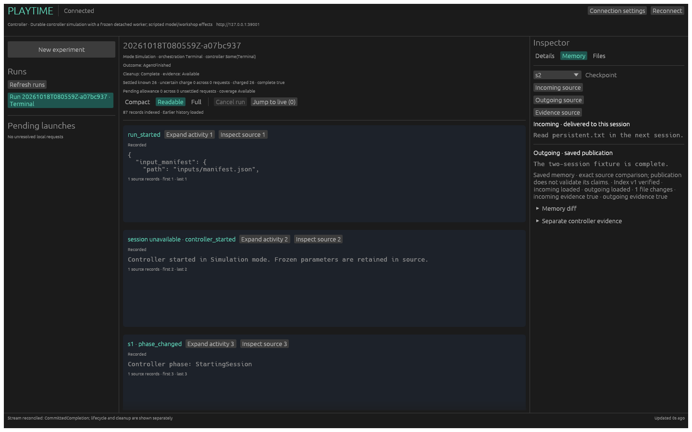

# Rust daemon and archive-backed API

`playtimed` runs the bounded controller in a separately supervised packaged
worker. Its ordinary HTTP handlers, native client, CLI and workbench observe
actual portable archives. The default `two-session` recipe uses scripted model
and workshop effects; [Docker run-and-view](rust-docker-run-and-view.md),
[live inference](rust-live-model.md), and the [recipe catalog](rust-recipes.md)
add native execution through the same application boundary.

This guide covers admission, confirmed reads, lifecycle publication, restart
reattachment and the CPU simulation gates. Archive recovery after worker loss is
not implemented. The [recovery planner](rust-recovery-contract.md) supports
explicitly recoverable simulations, but normal daemon preparation does not opt
into that capability or grant permission to repair these archives.

## Build, launch and view

Build a frozen static worker explicitly before starting the service. See
[rust-worker-package.md](rust-worker-package.md) for the pinned musl prerequisites.
Use new output directories; neither admission nor execution invokes Cargo.

```sh
rustup target add x86_64-unknown-linux-musl --toolchain 1.94.1
cargo run --locked -p xtask -- bundle-worker --output /absolute/new-worker-bundle
cargo build --locked -p playtime-server --bin playtimed -p playtime-cli --bin playtime
mkdir -m 700 /absolute/service-root
target/debug/playtimed --root /absolute/service-root --bundle /absolute/new-worker-bundle
```

The default is Linux user-systemd supervision, with no subprocess fallback.
The worker installs invocation/READY notification, ExecStopPost diagnostic
and SIGTERM hooks. READY follows grant consumption and initial publication.
SIGTERM requests cancellation before the frozen work deadline; at that deadline
it lets the controller's clock establish the wall stop. It retains pending
publication until settled; the manager independently enforces startup/runtime
bounds and stop grace. Worker control remains protocol v1.

For an isolated CPU test, add `--cpu-test-supervisor --listen 127.0.0.1:0`.
This supervisor accepts only the packaged controller simulation. It authenticates
its owned child and establishes termination by reaping it. A restarted daemon
adopts the worker an earlier one started on this boot through a pidfd, opened
while that exact process runs: its saved PID and kernel start time must match.
Such a worker has exited once its pidfd says so, never because its PID is
missing or reused. So a restarted daemon can't observe a worker that exited
before the restart, and on the same boot that run can't be released. The
supervisor does not claim systemd deadlines or cgroup enforcement. The
capability response identifies this mode explicitly. A short absolute root
avoids Unix socket path limits.

```sh
target/debug/playtime --connection-file /absolute/service-root/.playtime/connection.json \
  run two-session --mode simulation --idempotency-key my-retained-key --wait
cargo run --locked -p playtime-ui -- \
  --connection-file /absolute/service-root/.playtime/connection.json
```

The capture below comes from the real service gate (87 committed events, two
controller sessions and 26 known tokens), using the pinned CPU renderer.



Select the resulting run in the workbench. Its history, memory comparison,
checkpoint indexes and artifact content come through authenticated HTTP. Closing
or detaching a client does not cancel execution. Native bearer/origin/loopback
policy is unchanged; the default port remains 8766.

The default catalog contains the opaque `two-session` recipe.
Its bytes are embedded in the service; preview revision binds those bytes
and the verified bundle ID. The HTTP request selects an ID and revision, never a
scenario, host pathname or command. Preview labels scripted model/workshop
identities and unavailable real adapters. Scripted command strings remain data.
Preparation freezes the selected bundle and recipe, materializes a private
executable and saves its grant/bootstrap identity. The worker independently
verifies those inputs and retains the same prepared writer through Begin.

## Confirmation authority and publication

Storage exposes these read-only interfaces, alongside the existing
non-deserializable `CommittedFrontier` path:

```rust
pub trait ConfirmationAuthority {
    fn authorize(&self, archive: &ArchiveIdentity) -> Result<ReadPrefix>;
}
ArchiveReader::confirmed_snapshot(&dyn ConfirmationAuthority) -> Result<Snapshot>
ArchiveReader::confirmed_snapshot_extending(&dyn ConfirmationAuthority, ReadPrefix) -> Result<Snapshot>
ArchiveReader::confirmed_snapshot_continuing(&dyn ConfirmationAuthority, &Snapshot) -> Result<Snapshot>
ArchiveReader::sub_snapshot(&Snapshot, ReadPrefix) -> Result<Snapshot>
ArchiveReader::page_within(&Snapshot, ReadPrefix, u64, u32) -> Result<EventPage>
Snapshot::check_position(&ReadPrefix) -> Result<()>
ArchiveQueries::from_snapshot(impl Into<Arc<ArchiveReader>>, Snapshot) -> Result<ArchiveQueries>
```

`ReadPrefix` contains sequence, exact byte count and SHA-256. It is position data,
not a writer receipt. The service's authority implementation is private to its
archive adapter and accepts authenticated replies or protected saved ledger
confirmations. Preparation's private archive identity binds descriptor, manifest
and run; worker/bootstrap/supervisor authentication also binds service, grant,
executable, original invocation and boot. Every Status request uses the existing
fresh nonce and authenticated Unix peer protocol.

Storage verifies inputs, exact JSONL prefix, sequence/byte count/digest, known
records and referenced/transitive content. It does not read the current marker
for these operations. Its deterministic v1 marker identity describes the selected
prefix, without manufacturing a commit receipt. Historical positions must be
exact record boundaries of a trusted covering snapshot, by sequence and running
digest, as the pass that validated it recorded them; a historical snapshot then
validates the prefix up to its position. A history page at a fixed frontier
needs no historical snapshot: it pages the records up to its position from the
published evidence, whose pass validated them, and checks the ones it returns
against that pass's digests. A checkpoint or artifact page whose cursor pins
the published frontier is served from the published evidence; one at an
earlier frontier takes the historical snapshot's pass. `docs/rust-storage.md`
says what a continued pass and a page check.

Publication order is explicit:

1. The coordinator authenticates Status and rejects regression/conflict.
2. The archive port validates the actual bytes of the reply's prefix and that
   they exactly extend the previous confirmed prefix, outside a ledger
   transaction. While the worker runs or cancels, it continues the pass that
   verified the previous confirmation over the new bytes only, with the reader
   it opened for that launch. A new reader and one pass over the whole prefix,
   which checks the previous prefix as a boundary within it, verify the first
   confirmation, any whose previous prefix isn't the port's latest, every
   confirmation from a worker in another state, and one at least every 60
   seconds, so a change to earlier bytes shows within a minute. A worker
   reports another state before its execution begins or after it ends without
   a normal outcome; after a normal end it still reports running or
   cancelling, and the completion check below validates the whole history
   again.
3. A guarded FULL-synchronous ledger transaction saves worker status and the
   separate `confirmed_read` boundary/provenance, checking ownership generation
   and admission revision again.
4. The application constructs and swaps a verified projection from that saved
   boundary, then wakes shared observers. It reuses the reader and snapshot the
   port's own verification produced for that boundary, for at most 16 runs; a
   changed boundary or a restarted daemon verifies again. The projection goes
   on from the fold of the run's previous one when that fold read a prefix of
   this boundary's history, reading only the newer records in pages that check
   their digests; otherwise, as after a restart, it reads the whole history in
   one validating pass (`ArchiveQueries::overview_from`). Each active run keeps
   its latest fold, for at most 16 runs, until it is terminal. Published
   evidence keeps its snapshot for reads only: 72 bytes a record for every
   published run, while the state a confirmation continues stays with the
   latest verification of at most 16 runs. The completion check reads the
   history only once storage has a committed run end. That read validates the
   whole prefix and its content again, and before the run completes a new
   reader hashes the frozen inputs again too. No handler publishes candidate
   reads.

Ledger version 5 preserves admission/service identity and migrates versions 1–4.
Version 5 adds the optional operator release; older binaries refuse it.
`confirmed_read` records the exact archive frontier, generation and `worker`
source; `last_status` remains the last worker confirmation. Later recovery must
add its own provenance rather than overwrite this origin. Equal confirmations
create no extra transition. Failed validation/publication retains the prior
verified projection with visible uncertainty and no terminal stream notice.
On daemon startup, saved prefixes are revalidated for inspection, and the active
run is reconciling until its worker authenticates again; see
[restarting the daemon](#restarting-the-daemon).

There is one coalesced refresh lane per run, a 250 ms floor, a five-second request
bound and failure backoff capped at five seconds. Observers share it. Cancellation
uses its independent control lane and publishes control metadata without waiting
for archive hashing/download capacity. Archive read jobs have four retained
permits, including after a caller times out. Public history pages verify the
records they return, and downloads their bytes; RunView and paired anchors come
from one published snapshot.
They read through the reader of the run's latest verification when the port has
one. Following history checks its cursor's position in the published snapshot
without reading the archive, and pages check each record they return against the
digest its validating pass recorded. A download checks that the published
snapshot references the content and verifies the content's bytes; it doesn't
validate the event log again.

## Results and safe completion

`RunView.accounting_coverage` is additive, optional and versioned. It binds
unsettled model request count and total original allowance to the same frontier
as settled usage. A missing field means not reported. Known/unknown settlements,
pending allowances and non-dispatch releases remain distinct; neither client
interprets absent coverage as complete accounting.

`Checkpoint.index` is an optional ordinary `ContentAvailability`. Its artifact
contains the exact versioned index, including memory delivery status, incoming
and outgoing evidence/provenance, file modes/sizes/digests, metadata-only/link
entries, changes and source maps. The compact `evidence` field means outgoing
evidence. Missing memory stays unavailable even when an index retains the empty
text delivered in its place; loaded-empty memory remains available empty bytes.
The shared client's `checkpoint_index` verifies download identity and hashes,
decodes supported indexes, and retains unsupported-schema bytes for inspection.

The catalog includes only references verified under its frontier: frozen inputs,
checkpoint indexes/leaves and retained large observation payloads. IDs bind run
and exact ContentRef. Artifact display names for saved files preserve logical
workspace names. Event envelopes/data are not rewritten; archive sequence and
controller sequence remain separate and source-map hashes cover exact LF-ended
archive bytes, not HTTP reserialization.

A committed terminal event alone cannot end observation or free admission.
Normal release additionally requires settled publication, no unsettled model
intent, successful committed cleanup, a non-interrupted/non-infrastructure
outcome, accepted supervisor stop and proven original-worker termination. The
final guarded transaction rechecks the original owner and confirmed boundary,
then releases the active slot. Pending, uncertain and interrupted runs remain
reserved until automatic recovery exists or the operator releases them.

A worker that reports a failed execution (status `failure`, see
[worker lifecycle](rust-worker-lifecycle.md)) has nothing left to publish once
its publication settles, so the daemon stops its unit then rather than at
`RuntimeMaxSec`, freeing the run and live-model locks. A cancelled run is
excluded; its own stop path handles it. Once the unit is observed stopped, the
run records Reconciling with reason `execution_failed` and stays reserved until
an operator releases it. The run's `orchestration.failure` carries the worker's
text, and still does after a release.

`playtime runs release RUN_ID --reason TEXT` is that explicit operator path. The
daemon refuses unless the run is not Terminal and, if a worker start was ever
submitted, the original invocation has stopped and every resource in the
worker's Docker ownership journal is absent by exact name. On the worker's own
boot, a fresh supervisor observation must show the invocation stopped with an
empty cgroup. A worker that started on an earlier boot has stopped, since no
process outlives its boot, so the release records the current boot ID
(`later_boot_id`) as that evidence instead (#43). A boot ID names a boot of one
host, so this assumes the root stays on the host that ran the worker.
Simulation workers own no external resources. Release lists what remains and
has no force option. Success records the time, reason and evidence, then sets
Terminal with reason `operator_released`, which frees the slot. The archive is
not modified: the last published checkpoint stays authoritative, unknown usage
stays unknown, and the live stream ends as `incomplete` rather than committed
completion. Private images/evidence are retained rather than removed underneath
an uncertain invocation. The Python launcher checks the Rust ledger while
holding the common flock, preserving exclusion during the reservation-to-worker
handoff and after uncertain worker loss.

## Restarting the daemon

The ledger marks the active run reconciling (`coordinator_restarted`) when the
daemon opens it. If a worker start was submitted on this boot, the daemon then
follows the run with the refresh that a launch starts, without preparing or
starting a worker again. It does so before it revalidates the rest of the
history and before the API serves. Unless the last observation saw the worker
stop, it first marks the run `control_uncertain`, control being resolved, so
clients don't take it for a run waiting for a release. A run it doesn't follow
keeps `coordinator_restarted`, which clients show as waiting for one.

Each refresh authenticates the original invocation through the supervisor and
the private control socket, and checks that its receipt extends the saved
confirmation, before the run is current again. A worker still waiting for Begin
gets its authorized Begin, after the grant, cancellation and startup-deadline
checks. A saved cancellation that hasn't stopped the worker is delivered again on
its own lane, and an accepted stop is only observed, never restarted.

The worker keeps its frozen executable, allocation, work clock and deadline, and
its key still names it; new previews use the new bundle. A daemon restarted with
another bundle can follow it only while its build keeps the worker control
protocol version and the unit checks, including `FINISH_MARGIN`. Neither that
nor the restart of a Docker or live worker is gated yet.

Under systemd, a worker that stopped while no daemon ran is lost like any other,
and its run waits for a release; so does a run whose preparation was cut short,
since it never started a worker. A worker that the daemon hasn't stopped ends at
the run's wall limit plus three minutes, so a daemon back before then still
confirms a finished run's end. No worker outlives a host reboot, so the daemon
doesn't follow a run whose worker started on an earlier boot. That run stays
reconciling until an operator releases it, and the reboot itself is the evidence
that its worker stopped. Release it rather than cancel it: a cancel can't reach
the worker and leaves the run `control_uncertain`, which clients don't show as
waiting for a release, though release still works. A Docker run's stopped
containers and volume outlive the reboot, so its release waits until they're
removed (`docker rm`, `docker volume rm`); the refusal names each one.

## Executable gate and remaining gates

```sh
./scripts/test-rust-service-e2e.sh --case normal
./scripts/test-rust-service-e2e.sh --case lifecycle
./scripts/test-rust-worker-package.sh
./scripts/test-rust-cli-e2e.sh --backend fixture
./scripts/test-rust-ui-e2e.sh --backend fixture
```

The normal gate explicitly builds its bundle and binaries, launches `playtimed`
on port zero with the CPU test supervisor and removes Cargo from its runtime
PATH. It first launches a run, cancels it at once and releases it through
`playtime runs release`; the slot must then admit the normal run. A normal CLI
launch executes two actual controller sessions. The shared
client checks history/SSE coverage, fixed historical anchors, idempotent replay,
26 known tokens, two checkpoints, exact memory, all artifact downloads and
source-map byte hashes. The existing workbench backend opens that run, verifies
session-two memory/index and renders its widgets. Folder-only inspection is
repeated after stopping the daemon and removing the original service root.
Processes, private credentials and roots belong to the bounded harness.

For an optional image of that actual run, build/run the `playtime-ui`
`service-e2e` example with `--features ui-snapshots`, the same `--daemon`, `--cli`
and `--bundle` paths, and `--screenshot /absolute/new-image.png`. It requires the
same pinned CPU Vulkan renderer as the reviewed UI screenshots and does not
regenerate any screenshot goldens. A separate default-systemd daemon invocation
using the launch commands above checks the real manager hooks; the CPU gate is
not evidence of independent enforcement.

The lifecycle gate runs the normal gate's run with the daemon killed in the
middle. As soon as the CPU supervisor records the worker's start, the gate pauses
the worker through a pidfd, before its control socket listens, so only a
restarted daemon can send its Begin. The gate then kills the daemon, restarts it
on the same root, port and bundle, and resumes the worker. A client from before
the restart must still reach the run, which is `control_uncertain` while its
worker is paused, and its key must still name it. The run must then finish
normally on that same worker, with every normal check passing, no other worker
for it, and its slot free for a waiting launch. A second run then has its worker
paused once it listens, and the daemon dies again as soon as its ledger holds
that run's cancellation. The restarted daemon must accept the stop itself, the
first view after the restart showing it only requested, and the run then waits
for a release, like any cancelled run. The gate becomes the workers' parent
(`PR_SET_CHILD_SUBREAPER`): otherwise the kernel ends a paused worker with SIGHUP
when its daemon's death orphans its process group. `--case lifecycle --backend
systemd` runs the same gate under user systemd; it is opt-in and not part of CI.
There the worker records itself just before it listens, so the gate records
whether it paused the worker in time instead of requiring it.

`--case recovery` is not supported by the service wrapper; worker-loss recovery
isn't planned (#58). Operator release is implemented; it does not write a
recovery settlement or complete the restart/crash failure matrix. See
[development](development.md#gates-that-are-not-implemented) for gate scope and
[recovery](rust-recovery-contract.md) for the read-only contract.
