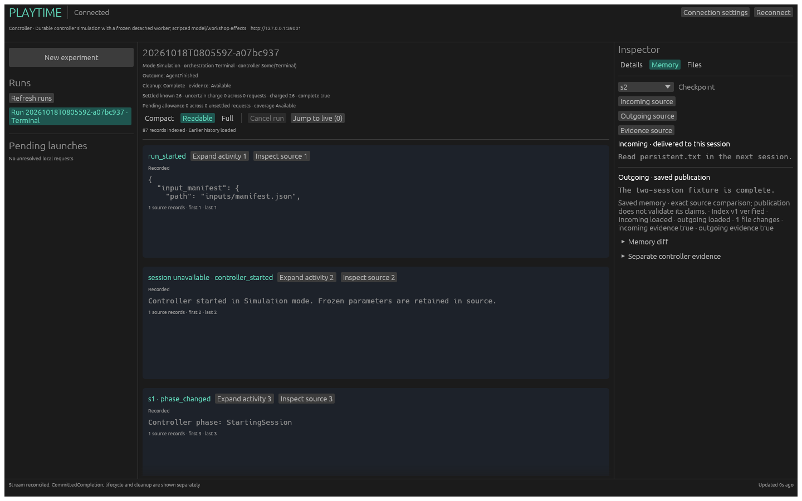

# Normal Rust daemon execution (#20, slice B)

The Docker/scripted-model production composition is now available through
[#66 run-and-view](rust-docker-run-and-view.md). The scope below describes its
underlying slice; live inference and automatic recovery remain separate work.

`playtimed` now runs the real bounded controller in a separately supervised,
packaged worker. Model and workshop effects are scripted. The ordinary HTTP
handlers, native client, CLI and workbench observe its actual portable archive.
This slice does not complete #20, #21 or #22: surviving-worker restart, worker-loss
recovery and the full CLI/UI simulation gates remain subsequent work. #50 owns
recoverable preparation and recovery protocol/planner contracts. This slice uses
the existing preparation profile; opting the daemon into #50's reviewed recovery
capability is a subsequent join, not an implied permission to recover these runs.

## Build, launch and view

Build a frozen static worker explicitly before starting the service. See
[rust-worker-package.md](rust-worker-package.md) for the pinned musl prerequisites.
Use new output directories; neither admission nor execution invokes Cargo.

```sh
rustup target add x86_64-unknown-linux-musl --toolchain 1.94.1
cargo run --locked -p xtask -- bundle-worker --output /absolute/new-worker-bundle
cargo build --locked -p playtime-server --bin playtimed -p playtime-cli --bin playtime
mkdir -m 700 /absolute/service-root
target/debug/playtimed --root /absolute/service-root --bundle /absolute/new-worker-bundle
```

The default is Linux user-systemd supervision, with no subprocess fallback.
The worker installs #52's invocation/READY notification, ExecStopPost diagnostic
and SIGTERM hooks. READY follows grant consumption and initial publication.
SIGTERM requests cancellation before the frozen work deadline; at that deadline
it lets the controller's clock establish the wall stop. It retains pending
publication until settled; the manager independently enforces startup/runtime
bounds and stop grace. Worker control remains protocol v1.

For an isolated CPU test, add `--cpu-test-supervisor --listen 127.0.0.1:0`.
This supervisor accepts only the packaged controller simulation. It authenticates
its owned child and establishes termination by reaping it, but does not claim
systemd deadlines, cgroup enforcement or restart reattachment. The capability
response identifies this mode explicitly. A short absolute root avoids Unix
socket path limits.

```sh
target/debug/playtime --connection-file /absolute/service-root/.playtime/connection.json \
  run two-session --mode simulation --idempotency-key my-retained-key --wait
cargo run --locked -p playtime-ui -- \
  --connection-file /absolute/service-root/.playtime/connection.json
```

The capture below comes from the real service gate (87 committed events, two
controller sessions and 26 known tokens), using the pinned CPU renderer.



Select the resulting run in the workbench. Its history, memory comparison,
checkpoint indexes and artifact content come through authenticated HTTP. Closing
or detaching a client does not cancel execution. Native bearer/origin/loopback
policy is unchanged; the default port remains 8766.

The service owns a frozen catalog containing the opaque `two-session` recipe.
The recipe bytes are embedded in the service; preview revision binds those bytes
and the verified bundle ID. The HTTP request selects an ID and revision, never a
scenario, host pathname or command. Preview labels scripted model/workshop
identities and unavailable real adapters. Scripted command strings remain data.
Preparation freezes the selected bundle and recipe, materializes a private
executable and saves its grant/bootstrap identity. The worker independently
verifies those inputs and retains the same prepared writer through Begin.

## Confirmation authority and publication

Storage exposes these read-only interfaces, alongside the existing
non-deserializable `CommittedFrontier` path:

```rust
pub trait ConfirmationAuthority {
    fn authorize(&self, archive: &ArchiveIdentity) -> Result<ReadPrefix>;
}
ArchiveReader::confirmed_snapshot(&dyn ConfirmationAuthority) -> Result<Snapshot>
ArchiveReader::sub_snapshot(&Snapshot, ReadPrefix) -> Result<Snapshot>
ArchiveQueries::from_snapshot(ArchiveReader, Snapshot) -> Result<ArchiveQueries>
```

`ReadPrefix` contains sequence, exact byte count and SHA-256. It is position data,
not a writer receipt. The service's authority implementation is private to its
archive adapter and accepts authenticated replies or protected saved ledger
confirmations. Preparation's private archive identity binds descriptor, manifest
and run; worker/bootstrap/supervisor authentication also binds service, grant,
executable, original invocation and boot. Every Status request uses the existing
fresh nonce and authenticated Unix peer protocol.

Storage verifies inputs, exact JSONL prefix, sequence/byte count/digest, known
records and referenced/transitive content. It does not read the current marker
for these operations. Its deterministic v1 marker identity describes the selected
prefix, without manufacturing a commit receipt. Historical positions must be
beneath a trusted covering snapshot and independently verify both prefixes.

Publication order is explicit:

1. The coordinator authenticates Status and rejects regression/conflict.
2. The archive port validates the actual bytes and extension of the previous
   confirmed prefix, outside a ledger transaction.
3. A guarded FULL-synchronous ledger transaction saves worker status and the
   separate `confirmed_read` boundary/provenance, checking ownership generation
   and admission revision again.
4. The application constructs and swaps a verified projection from that saved
   boundary, then wakes shared observers. No handler publishes candidate reads.

Ledger version 4 preserves admission/service identity and migrates versions 1–3.
`confirmed_read` records the exact archive frontier, generation and `worker`
source; `last_status` remains the last worker confirmation. Later recovery must
add its own provenance rather than overwrite this origin. Equal confirmations
create no extra transition. Failed validation/publication retains the prior
verified projection with visible uncertainty and no terminal stream notice.
On daemon startup, saved prefixes are revalidated for inspection; active runs
remain reconciling. This slice does not resume their refresh/launch actors.

There is one coalesced refresh lane per run, a 250 ms floor, a five-second request
bound and failure backoff capped at five seconds. Observers share it. Cancellation
uses its independent control lane and publishes control metadata without waiting
for archive hashing/download capacity. Archive read jobs have four retained
permits, including after a caller times out. Public history and downloads verify
their pinned bytes; RunView and paired anchors come from one published snapshot.

## Results and safe completion

`RunView.accounting_coverage` is additive, optional and versioned. It binds
unsettled model request count and total original allowance to the same frontier
as settled usage. A missing field means not reported. Known/unknown settlements,
pending allowances and non-dispatch releases remain distinct; neither client
interprets absent coverage as complete accounting.

`Checkpoint.index` is an optional ordinary `ContentAvailability`. Its artifact
contains the exact versioned index, including memory delivery status, incoming
and outgoing evidence/provenance, file modes/sizes/digests, metadata-only/link
entries, changes and source maps. The compact `evidence` field means outgoing
evidence. Missing memory stays unavailable even when an index retains the empty
text delivered in its place; loaded-empty memory remains available empty bytes.
The shared client's `checkpoint_index` verifies download identity and hashes,
decodes supported indexes, and retains unsupported-schema bytes for inspection.

The catalog includes only references verified under its frontier: frozen inputs,
checkpoint indexes/leaves and retained large observation payloads. IDs bind run
and exact ContentRef. Artifact display names for saved files preserve logical
workspace names. Event envelopes/data are not rewritten; archive sequence and
controller sequence remain separate and source-map hashes cover exact LF-ended
archive bytes, not HTTP reserialization.

A committed terminal event alone cannot end observation or free admission.
Normal release additionally requires settled publication, no unsettled model
intent, successful committed cleanup, a non-interrupted/non-infrastructure
outcome, accepted supervisor stop and proven original-worker termination. The
final guarded transaction rechecks the original owner and confirmed boundary,
then releases the active slot. Pending, uncertain and interrupted runs remain
reserved for later recovery. Private images/evidence are retained rather than
removed underneath an uncertain invocation. The Python launcher checks the
Rust ledger while holding the common flock, preserving exclusion during the
reservation-to-worker handoff and after uncertain worker loss.

## Executable gate and remaining gates

```sh
./scripts/test-rust-service-e2e.sh --case normal
./scripts/test-rust-worker-package.sh
./scripts/test-rust-cli-e2e.sh --backend fixture
./scripts/test-rust-ui-e2e.sh --backend fixture
```

The normal gate explicitly builds its bundle and binaries, launches `playtimed`
on port zero with the CPU test supervisor and removes Cargo from its runtime
PATH. A normal CLI launch executes two actual controller sessions. The shared
client checks history/SSE coverage, fixed historical anchors, idempotent replay,
26 known tokens, two checkpoints, exact memory, all artifact downloads and
source-map byte hashes. The existing workbench backend opens that run, verifies
session-two memory/index and renders its widgets. Folder-only inspection is
repeated after stopping the daemon and removing the original service root.
Processes, private credentials and roots belong to the bounded harness.

For an optional image of that actual run, build/run the `playtime-ui`
`service-e2e` example with `--features ui-snapshots`, the same `--daemon`, `--cli`
and `--bundle` paths, and `--screenshot /absolute/new-image.png`. It requires the
same pinned CPU Vulkan renderer as the reviewed UI screenshots and does not
regenerate any screenshot goldens. A separate default-systemd daemon invocation
using the launch commands above checks the real manager hooks; the CPU gate is
not evidence of independent enforcement.

`--case lifecycle` and `--case recovery` are intentionally not implemented here.
The existing CLI/UI `--backend simulation` gates still fail explicitly until the
full #20/#43 integration exists. Restart/upgrade, worker loss, recovery writes,
operator abandonment and the parent crash/failure matrix remain open. Recovery
settlement DTO/planner changes belong to #50 and are not guessed in this slice.
