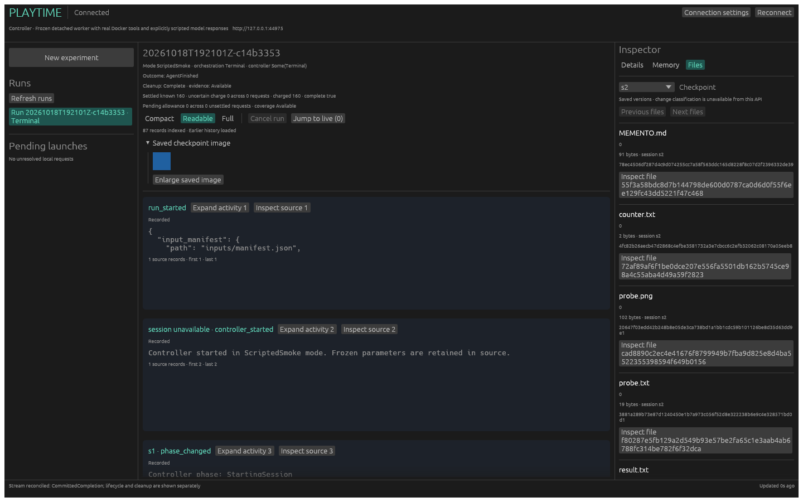

# Packaged Docker run-and-view

The `docker-two-session` catalog recipe runs the real controller in a frozen,
user-systemd worker. Its five model replies are scripted; its tools, session
processes, workspace capture, archive publication and client downloads are real.
The same controller and archive encoder also retain the existing simulation path.
The [live-model path](rust-live-model.md) and [reviewed recipe catalog](rust-recipes.md)
add real inference and seeds through this composition. Model-host enforcement,
automatic image restoration, daemon restart reattachment, and archive recovery
remain unimplemented.

## Run it

Build the worker explicitly before starting the service:

```sh
cargo run --locked -p xtask -- bundle-worker --output /absolute/new-bundle
cargo build --locked -p playtime-server --bin playtimed -p playtime-cli --bin playtime
mkdir -m 700 /absolute/service-root
target/debug/playtimed --root /absolute/service-root --bundle /absolute/new-bundle --docker-scripted
target/debug/playtime --connection-file /absolute/service-root/.playtime/connection.json \
  run docker-two-session --mode scripted_smoke --idempotency-key my-retained-key --wait
cargo run --locked -p playtime-ui -- \
  --connection-file /absolute/service-root/.playtime/connection.json
```

The service root and every directory above it must belong to you or root and
must not be group- or world-writable; only a root-owned sticky directory such as
`/tmp` may be. Otherwise `playtimed` exits at startup with `invalid or unsafe
local credential/discovery file`. `mkdir -m 700` sets only the root's own mode,
so a parent created under umask 002 still trips this; `chmod g-w` that parent.

`--docker-scripted` enables the additional service-owned catalog entry. Default
Docker selection is `/usr/bin/docker` and `/var/run/docker.sock`; an operator can
supply `--docker-executable` and `--docker-socket` before service startup. Clients
select an opaque recipe/revision, never paths, scripts or arbitrary scenarios.
The ordinary `two-session --mode simulation` recipe remains available. The CPU
test supervisor rejects real Docker capabilities; there is no fallback when
systemd or the locked image is unavailable.

The service checks Docker metadata and the locked image at startup and admission.
It freezes the selected executable digest, canonical socket, daemon identity,
image lock, embedded helper digests, bundle identity, configuration version,
prompts, scripted replies and resource/storage/capture limits. The worker repeats
those checks independently before effects. No admission, preview or execution
invokes Cargo, searches source files, refreshes the image or calls a model.
The worker receives `PATH=/no-runtime-cargo` under systemd.

The profile is `docker_scripted_no_seed_self_v1`, with private worker kind
`docker_scripted` and archive/run mode `scripted_smoke`. This profile requires a
bundle advertising `real_workshop` and a matching
`docker_profile` digest. Current bundles also advertise `real_model` for live
execution. The digest covers compiled templates, recipe bounds and embedded
identities, excluding the host's Docker selection and daemon identity.
`--docker-scripted` startup refuses a bundle whose digest differs from
the service's own, so a bundle from another revision cannot pass admission and
then stall in `Reconciling`. The preview revision includes the digest. The worker
and producer reject unsupported profile versions and modifications
to this fixed recipe's prompts/limits. This smoke profile has no seeds and uses
`self` memory; the separate catalog-recipe profile supports seeds. Older simulation
bundles/archives retain their existing path. `controller_archive_v1` recovery
does not authorize this Docker profile;
its configuration cannot decode as the simulation recovery contract.

The fixed recipe and prompts live in
[`smoke.json`](../crates/playtime-runner/src/docker/smoke.json). The adjacent image
lock is an exact, versioned copy of the existing locked workshop identity, not a
new image or a refreshed lock. The fixture performs five responses with 32
synthetic generated tokens each:

1. Create `probe.txt`, a deterministic 32×32 PNG, `/tmp/transient` and a background
   counter as uid 1000.
2. Execute a one-second sleep with a requested 0.1-second bridge timeout.
3. Save the first memento and checkpoint.
4. In a new conversation/session, verify retained files, fresh `/tmp` and a stopped
   old counter, then write `result.txt` containing `persistence-ok`.
5. Save the final memento, checkpoint and cleanup outcome.

The limits are two sessions, six work turns/session, 120 work seconds, 4,096 total
output tokens, 512/request, 256/handoff, 30-second model and five-second command
caps, 4,096 output bytes, 2,048 memento bytes and an 8 MiB event log. Resources are
one CPU, 1,024 MiB memory, 8 MiB workspace, 16 MiB tmp and 64 PIDs. Scripted context
is 32,768: the conservative byte-based context guard must fit the fixed commands
and tool schemas. The live smoke also uses 32,768; catalog recipes supply their
own bounded context. Storage defaults are unchanged.

## Dispatch and ownership

`playtime-runner::Effects` is a bounded port behind the existing archive driver.
The scripted adapter implements the same interface. The driver commits each
intent before dispatch, keeps servicing time/cancellation/storage receipts, and
waits for an old native operation to retire before accepting another operation.
One retained actor owns one sandbox, with one request and one reply slot. Dropped
or cancelled observation does not create a replacement owner.

The exact prepared writer still moves through authenticated grant consumption
and Begin. Docker preparation creates no controller/work clock and no sandbox.
The original consumed Begin timestamp selects the work deadline; there is no
fresh allocation after asynchronous preparation. Start is bounded by 20 seconds
and the work deadline; stop/capture shares 80 seconds with at most 20 for
quiescence; publication is bounded by 20; final Docker cleanup has one aggregate
20-second bound. The holder retains the original deadline plus 180-second grace.

Each resource proposal is durably written to a service-private, one-use
`docker-<role>-<session>.json` before Docker create. It binds the full private
worker binding (including run/manifest/grant/invocation), exact committed effect
intent/frontier and full sandbox proposal. Files are bounded, mode 0600, no-follow,
synced with their directory and never overwritten. A cancelled journal operation
retains its filesystem owner/permit; uncertainty cannot authorize a retry.
These records survive worker loss and are not experimental writer receipts.

`ToolPolicy::ConfirmedExternal` distinguishes bridge completion from transport
expiry. The bridge's requested command timeout stays inside the frozen five-second
effect cap, with a three-second return allowance deducted from the remaining
transport budget. The allowance covers the Docker calls around `docker exec` and
the bridge's own kill and reap, which can wait 2 s. The work deadline still clips
that cap. When less than the allowance remains before the work deadline, the
worker doesn't contact Docker and the run ends with `wall_limit`. A valid bridge
timeout can continue the script. A deadline/lost reply or late completion closes further
model/tool dispatch with infrastructure failure, without fabricating a timeout
result or changing the first stop reason to user cancellation. Snapshot requires
independent quiescence even after the local Docker CLI has exited.

## Capture, publication and completion

A quiescent borrow spans export, memory reading, validation and final identity
checks. The adapter passes exact tar and regular-file bytes to the existing
`Encoder::checkpoint_contents`. Logical names never become host filesystem paths.
Links/directories retain metadata only. Actual outgoing memory, delivered incoming
memory, loaded-empty/missing status, file modes, hashes and source maps remain
separate and inspectable.

Each non-deserializable `CommittedFrontier` now carries cumulative object bytes,
references, events and log bytes from its actual writer state. Unreferenced staged
objects do not advance these counts. Capture starts from that receipt, including
frozen worker/source inputs and prior checkpoints. It reserves two maximum-size
manifests for the canonical index/source map, two bounded memory leaves, 16
references/events and four maximum event records for this fixed no-evidence
profile. Candidate tar, duplicated regular bodies, index and outgoing memory are
then checked against the remainder. All arithmetic is checked. The writer also
checks actual publication bytes; no fresh-zero allowance is used per checkpoint.

Only the existing storage thread publishes candidates. Successful capture or
handoff is not publication. Failed writers never retry; late receipts retain
writer ownership and can advance confirmed evidence only when actually returned.
A second-capture failure retains 160 known tokens and the saved handoff, leaves
checkpoint one authoritative, and reports cleanup independently. User cancellation
aborts in-flight model and tool effects but never Snapshot, publication or
cleanup. A cancel during capture therefore still publishes that session's
interrupted checkpoint, within the 80-second stop/capture bound.

Normal admission release requires committed terminal/accounting evidence, settled
publication, exact successful Docker cleanup and original-worker termination.
Interrupted/infrastructure outcomes report `Reconciling`; worker/API loss leaves
the admission and private ownership evidence reserved. Restart can inspect saved
confirmed prefixes but does not automatically launch a replacement, finalize,
recover, or release these runs. Explicit `playtime runs release` verifies original
worker termination and owned-resource absence before freeing admission; it leaves
the archive unchanged.

The worker applies the same rule to controller simulation. A simulation run that
ends interrupted, with an infrastructure failure or with incomplete cleanup shows
`Reconciling`, not `Running`. Its admission stays reserved as before, because
normal completion already refused such runs; `playtime runs release` (#80) frees
it.

## Executable evidence

```sh
./scripts/test-rust-service-e2e.sh --case run-and-view --backend docker-scripted
./scripts/test-rust-service-e2e.sh --case normal
./scripts/test-rust-docker-e2e.sh --case sandbox
./scripts/test-rust-docker-e2e.sh --case checkpoint
./scripts/test-rust-worker-package.sh
./scripts/test-rust-cli-e2e.sh --backend fixture
./scripts/test-rust-ui-e2e.sh --backend fixture
```

Run-and-view has a 540-second bound after explicit build/preparation. It uses the
actual user-systemd supervisor, real Docker and the existing native client/CLI/UI.
It verifies exactly 160 known and zero unknown tokens, two checkpoints, transcript,
actual bridge timeout, memory, all artifact downloads and source-map byte hashes.
It also checks, from archived records, that session two's first request is a new
conversation carrying the delivered memento. That check used to be fixture logic
inside the production effect owner. A second run launched with `run --wait` must
then return 0, because starting and finishing never look like a run that needs a
release (#93).
The deterministic PNG is 102 bytes with SHA-256
`20647f03edd42b248b8e05de3ca738bd1a1bb1cdc59b101126be8d35d63dd9e1`.
The workbench attaches while the run is active, disconnects, then reopens after
normal completion. It decodes the PNG outside rendering, inspects text and renders
the same run using the pinned Mesa software Vulkan renderer.

The wrapper retains `workbench.png`, artifact/run/absence JSON and an independently
read copied archive. The service's selected bundle copy is removed after startup;
the original service root is removed before the final folder-only inspection.
All four exact proposed Docker resources are independently checked absent on the
original daemon. Existing screenshot goldens are not replaced.

A separate explicit probe kills the original systemd worker after its first
confirmed tool reply. It verifies no replacement/tool replay, a blocked new
admission and retained `Reconciling` ownership, including after daemon restart.
Its disposable admission ledger and private proposal records remain on disk.
The killed worker also leaves a failed `playtime-<id>.service` user unit, so
`systemctl --user is-system-running` reports `degraded`. Clear it with
`systemctl --user reset-failed 'playtime-*'`, which leaves active units alone.
Test-only teardown removes only its
three independently verified resources after original-worker death; it neither
writes recovery evidence into the archive nor releases admission. Default CPU CI
uses typed fake ports and the real controller/writer for capture/publication
failure, late receipt, cumulative capacity, cancellation, owner loss and daemon
uncertainty. It never executes command text or accesses Docker/GPU.

The 2026-10-18 invoked gate produced run `20261018T192101Z-c14b3353`: 87 committed
events, two checkpoints, 160 known tokens, zero unknown/pending allowance and 27
verified downloads. Independent absence checks covered all four exact resource
proposals. The separate original-worker-loss probe also passed across daemon
restart with admission still reserved. Its archive/evidence directory is retained
by the wrapper, outside version control.



The screenshot is documentation of that real run, not a synthetic screenshot
golden. It uses llvmpipe/Mesa 26.0.8-1ubuntu0.3 with LLVM 21.1.8. Validation also
passed 417 workspace Rust tests, locked all-target Clippy, formatting, 101 Python
tests with Docker enabled, the package gate (including producer/executing-worker
Docker rejection cases), the existing normal-service gate, both Docker gates,
12 CLI fixture process cases and two UI fixture process cases.

This evidence establishes Docker/scripted execution and review. The separate
[live gate](rust-live-model.md#evidence) adds direct Ollama execution. Neither
establishes model-host enforcement, automatic restart/recovery, or image
restoration. See [development](development.md) for current gate coverage.
