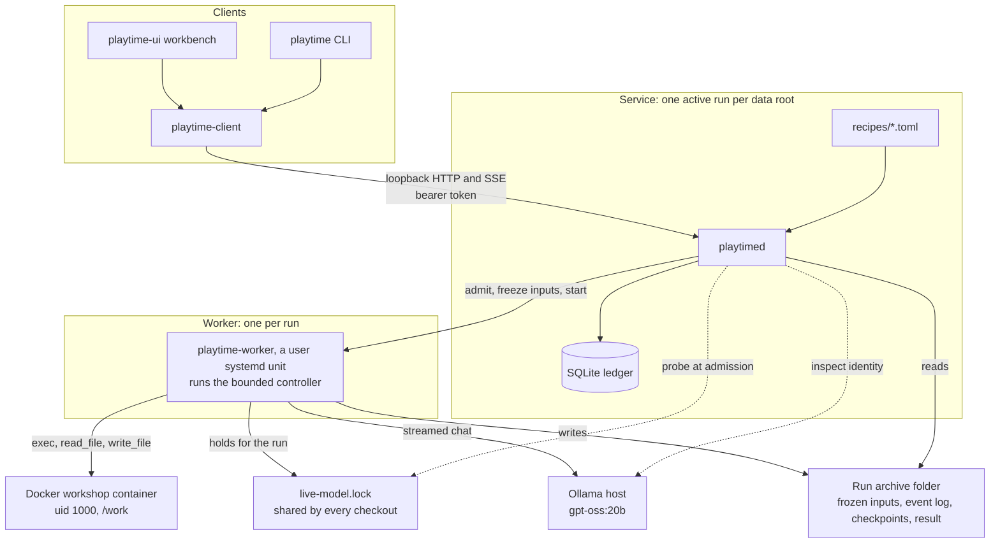

# Rust MVP

The Rust MVP is the point where Playtime's daemon, CLI and workbench run a long
real-model experiment unattended and let a person review it afterwards. #16
defines it, and the [Rust MVP milestone](https://github.com/aortez/playtime/milestone/2)
held its slices. It was released as v0.1.0. The soak's report on #75 and the
follow-up checks on #16 give the evidence for each of #16's items. This
document says how the parts fit, how a run goes and how to run it.

## Goal

Run the reviewed `curiosity` recipe, 10 sessions of `gpt-oss:20b` with a seed
pack and a 64K context, unattended, then browse every session's transcript,
memento, files and images.

## Parts



**Daemon.** `playtimed` (`playtime-server`) owns admission and the worker's
lifecycle. It loads the reviewed recipe catalog at startup, checks Docker, the
locked image and the model's identity at startup and at each admission, and
admits one run per data root. It serves a loopback-only HTTP API; clients read
the endpoint and bearer token from `<root>/.playtime/connection.json`. Don't
restart the daemon during a run: reattaching to a surviving worker is #59.

**Worker.** A static musl bundle (`playtime-worker`, built by `xtask
bundle-worker`) runs as a user systemd unit, one per run. It takes the
machine-wide live-run lock, verifies the frozen identities again, starts the
workshop container, writes the seeds, and runs the bounded controller
(`playtime-engine`) with real effects: the Docker workshop (`playtime-docker`),
the Ollama adapter (`playtime-ollama`) and the archive writer
(`playtime-storage` through `playtime-runner`). Nothing invokes Cargo during
admission or execution.

**Clients.** The CLI `playtime` (`playtime-cli`) and the workbench `playtime-ui`
share one client (`playtime-client`): authenticated HTTP, an acknowledged event
stream, durable launch receipts and verified downloads. Closing or detaching a
client never cancels a run; only an explicit cancel does. The workbench shows
the recipe preview, launches, a grouped live transcript, mementos, files and
images.

**Archive.** Each run is a self-contained folder: the frozen profile with its
recipe and seeds in `inputs/scenario.json`, the event log, a workspace capture
per session, and the result. It can be copied and read without the service's
SQLite ledger, which holds only admission and bookkeeping.

**Recipes.** `recipes/*.toml` are reviewed data. The daemon checks each against
compiled bounds and freezes the chosen one into the archive at admission.
Changing a recipe means editing the file and restarting the daemon between runs.

**Backend guard.** `playtime-backend-guard` is merged but outside the MVP's run
path. The MVP detects contention and records it; it doesn't enforce ownership
of the model host (#67, #70).

## How a run goes

1. **Preview.** A client asks for a recipe's preview. The daemon shows the
   effective profile under one revision: recipe, seeds, limits, model and image
   identity, bundle identity and readiness.
2. **Launch.** The client posts the launch with an idempotency key. The daemon
   probes the live-run lock, checks the identities, admits the run, freezes the
   inputs and starts the worker unit. A second live launch from any checkout
   gets `run_busy`.
3. **Sessions.** Each session is a fresh conversation. The model gets the
   prompt, the protocol, the inventory, its remaining budgets and
   `/work/MEMENTO.md`. Tool calls run inside the container as uid 1000, and only
   `/work` persists. A session ends with `end_session` or at its limits, and the
   worker captures `/work` into a checkpoint.
4. **Watching.** Clients follow the event stream with acknowledged frontiers and
   see partial thinking and output as coalesced chunks. The daemon paces the
   stream by the client's queue.
5. **End.** A run ends when the model sets `finish_run`, at the session cap, the
   wall limit or the token budget, on a failure, or on cancel. The result
   records the reason, the usage with unknown usage charged at its allowance,
   the identities, the contention flags and the cleanup state. A cancelled or
   failed run stays `reconciling` until `playtime runs release` (#80) frees the
   slot.
6. **Review.** The CLI and the workbench browse the archive by run, and a copied
   archive opens the same way.

## Run it

Build the worker bundle and the binaries, then start the daemon on a new root
with the live endpoint and the recipe catalog:

```sh
rustup target add x86_64-unknown-linux-musl --toolchain 1.94.1
cargo run --locked -p xtask -- bundle-worker --output /absolute/new-bundle
cargo build --locked -p playtime-server --bin playtimed -p playtime-cli --bin playtime \
  -p playtime-ui --bin playtime-ui
mkdir -m 700 /absolute/service-root
target/debug/playtimed --root /absolute/service-root --bundle /absolute/new-bundle \
  --docker-scripted --ollama-endpoint http://oldman-bird.local:11434 \
  --recipes /absolute/checkout/recipes
```

Launch from the CLI, or from the workbench, and cancel or release from the CLI:

```sh
target/debug/playtime --connection-file /absolute/service-root/.playtime/connection.json \
  run curiosity --mode experiment --idempotency-key my-retained-key --wait
target/debug/playtime-ui --connection-file /absolute/service-root/.playtime/connection.json
target/debug/playtime --connection-file /absolute/service-root/.playtime/connection.json \
  runs cancel RUN_ID --wait
target/debug/playtime --connection-file /absolute/service-root/.playtime/connection.json \
  runs release RUN_ID --reason "why"
```

Rules for live runs:

- One live run at a time. Before launching, check that
  `systemctl --user list-units 'playtime-*' --state=active` lists no worker.
- The owner stays off the model host while a run is live, and nothing changes
  the model host; identity checks are read-only metadata calls.
- Don't restart the daemon during a run.
- Recipe limits change only with the owner's review.
- Keep every attempt as a record, including failed ones.

CI runs the `foundation`, `worker-package`, `service-normal` and `ui-snapshots`
jobs. The Docker, live-model and backend-guard gates in `scripts/` run by hand,
on the machine with the locked image and the model host.

## Not in the MVP

These issues come next, in an order the owner sets:

- Host enforcement or the guard in the run path (#67, #68 as written, #70).
- Automatic recovery and reattaching to a running worker after a daemon
  restart (#43, #58, #59).
- Remote access (#25), reports (#26), repeat and pilots (#27).
- Legacy work (#44, and #28's parity matrix).
- Research features (#2 to #15), including the launcher's recipe variations,
  parameter and model choice, seed upload and readiness checks (#2 to #7).
- CI polish (#40), apart from the flake fixes.
- The larger exec-schema measurement (#82). The MVP keeps schema A with a
  per-session parse-error cap.

## Documents

| Area | Crates | Documents |
| --- | --- | --- |
| Values and wire contracts | `playtime-core`, `playtime-protocol` | [Foundation](rust-foundation.md), [compatibility and goldens](rust-compatibility.md) |
| Controller | `playtime-engine` | [Controller](rust-controller.md), [transcript contract](rust-archive-bridge.md) |
| Archives and the run driver | `playtime-runner`, `playtime-storage` | [Storage](rust-storage.md), [archive driver](rust-archive-driver.md), [recovery contract](rust-recovery-contract.md) |
| Recipes | `recipes/`, `playtime-runner`, `playtime-server` | [Recipes](rust-recipes.md) |
| Workshop | `playtime-docker` | [Docker sandbox](rust-docker.md), [workspace capture](rust-workspace-capture.md) |
| Model | `playtime-ollama` | [Live model](rust-live-model.md) |
| Worker | `playtime-worker`, `playtime-worker-control`, `xtask` | [Worker package](rust-worker-package.md), [worker lifecycle](rust-worker-lifecycle.md) |
| Daemon and API | `playtime-server` | [Daemon](rust-daemon.md), [HTTP API](rust-http-api.md), [run-and-view](rust-docker-run-and-view.md) |
| Clients | `playtime-cli`, `playtime-client`, `playtime-local`, `playtime-ui` | [CLI](rust-cli.md), [workbench](rust-ui.md) |
| Backend guard | `playtime-backend-guard` | [Backend guard](rust-backend-guard.md) |
| Test fixtures | `playtime-test-support` | [CLI](rust-cli.md) |
