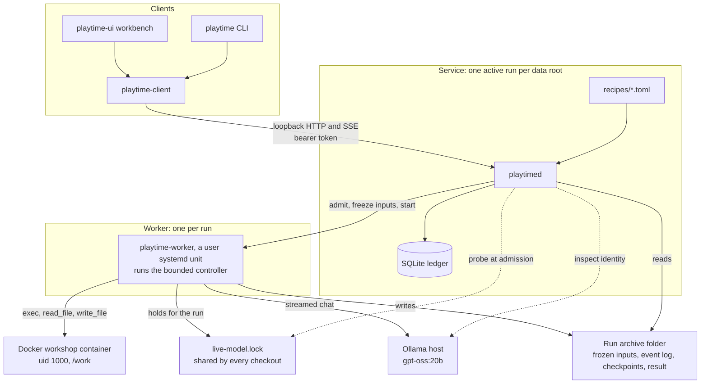

# Rust MVP

The Rust MVP is the point where Playtime's daemon, CLI and workbench run a long
real-model experiment unattended and let a person review it afterwards. #16
defines it, and the [Rust MVP milestone](https://github.com/aortez/playtime/milestone/2)
holds its slices. This document says what the MVP is, how its parts fit, what
is done and what remains. When the MVP is declared, the status sections come
out and the rest becomes the architecture document.

## Status on 2026-10-18

Every slice is merged, and the soak has run:

| Slice | Issue | Pull requests | State |
| --- | --- | --- | --- |
| 1. Docker workshop with a scripted model | #66 | #69 | Merged. |
| 2. Operator release for interrupted or failed runs | #71, #87 | #80, #88 | Merged. #93: `--wait` can exit 9 on a normal run. |
| 3. Live model called directly, with a live-run lock and contention flags | #72 | #83 | Merged. |
| 4. Tool-call robustness | #73 | #81, #85 | Merged. |
| 5. Recipes as data, seed import, long-run limits | #74 | #84 | Merged. The owner accepted the recipe text. |
| 6. One real 10-session soak run | #75 | | The owner's run `20261019T040629Z-5766d327` completed all 10 sessions unattended. The report is on #75. |

Also merged: #77 froze Python and retired the legacy matrix, #79 and #86 took
the backend-guard flake out of CI, and #89 fixed a worker test flake. The soak
filed #93 and #94.

## Goal

Run the reviewed `curiosity` recipe, 10 sessions of `gpt-oss:20b` with a seed
pack and a 64K context, unattended, then browse every session's transcript,
memento, files and images.

## Done when

| # | Item | State | Evidence |
| --- | --- | --- | --- |
| 1 | The reviewed curiosity recipe can be launched from the CLI or the workbench. | Done. The owner launched the soak from the workbench, and #84's live check launched from the CLI. | Soak run `20261019T040629Z-5766d327`; run `20261018T235429Z-9911f51c`. |
| 2 | It runs unattended to completion, with at most one live run across both checkouts. | Done. The soak ran 10 sessions to `agent_finished` with no intervention, and in #83's live gate the lock refused an admission from a second daemon root. | The #75 report; [Live model](rust-live-model.md). |
| 3 | You can watch it live, and closing or reopening the workbench never affects the run. | The workbench stayed open on the soak from launch to the end. Closing and reopening was verified at two sessions, not during the soak. | The #75 report; #83's live gate, run `20261018T222321Z-4e0ce29b`. |
| 4 | Cancel works. After a cancel or a failure, the owner can release the slot and launch again. | Cancel verified live. Release is merged (#80, #88), and the normal service gate cancels, releases and launches again; release hasn't run live. #93: `--wait` can exit 9 on a normal run. | #84's live check, the same run as item 1; `./scripts/test-rust-service-e2e.sh --case normal`. |
| 5 | Afterwards, every session's transcript, memento, files and images can be browsed, including from a copied archive. | Done at ten sessions, including an offline read of a copied archive. | The #75 report. |
| 6 | Each run records the model and image identity and flags possible GPU contention. | Done. The soak froze both identities, and its 111 timed requests flagged no contention. | The #75 report; [Live model](rust-live-model.md). |

The soak's report on #75 gives each item's evidence.

## Parts



**Daemon.** `playtimed` (`playtime-server`) owns admission and the worker's
lifecycle. It loads the reviewed recipe catalog at startup, checks Docker, the
locked image and the model's identity at startup and at each admission, and
admits one run per data root. It serves a loopback-only HTTP API; clients read
the endpoint and bearer token from `<root>/.playtime/connection.json`. Don't
restart the daemon during a run: reattaching to a surviving worker is #59.

**Worker.** A static musl bundle (`playtime-worker`, built by `xtask
bundle-worker`) runs as a user systemd unit, one per run. It takes the
machine-wide live-run lock, verifies the frozen identities again, starts the
workshop container, writes the seeds, and runs the bounded controller
(`playtime-engine`) with real effects: the Docker workshop (`playtime-docker`),
the Ollama adapter (`playtime-ollama`) and the archive writer
(`playtime-storage` through `playtime-runner`). Nothing invokes Cargo during
admission or execution.

**Clients.** The CLI `playtime` (`playtime-cli`) and the workbench `playtime-ui`
share one client (`playtime-client`): authenticated HTTP, an acknowledged event
stream, durable launch receipts and verified downloads. Closing or detaching a
client never cancels a run; only an explicit cancel does. The workbench shows
the recipe preview, launches, a grouped live transcript, mementos, files and
images.

**Archive.** Each run is a self-contained folder: the frozen profile with its
recipe and seeds in `inputs/scenario.json`, the event log, a workspace capture
per session, and the result. It can be copied and read without the service's
SQLite ledger, which holds only admission and bookkeeping.

**Recipes.** `recipes/*.toml` are reviewed data. The daemon checks each against
compiled bounds and freezes the chosen one into the archive at admission.
Changing a recipe means editing the file and restarting the daemon between runs.

**Backend guard.** `playtime-backend-guard` is merged but outside the MVP's run
path. The MVP detects contention and records it; it doesn't enforce ownership
of the model host (#67, #70).

## How a run goes

1. **Preview.** A client asks for a recipe's preview. The daemon shows the
   effective profile under one revision: recipe, seeds, limits, model and image
   identity, bundle identity and readiness.
2. **Launch.** The client posts the launch with an idempotency key. The daemon
   probes the live-run lock, checks the identities, admits the run, freezes the
   inputs and starts the worker unit. A second live launch from any checkout
   gets `run_busy`.
3. **Sessions.** Each session is a fresh conversation. The model gets the
   prompt, the protocol, the inventory, its remaining budgets and
   `/work/MEMENTO.md`. Tool calls run inside the container as uid 1000, and only
   `/work` persists. A session ends with `end_session` or at its limits, and the
   worker captures `/work` into a checkpoint.
4. **Watching.** Clients follow the event stream with acknowledged frontiers and
   see partial thinking and output as coalesced chunks. The daemon paces the
   stream by the client's queue.
5. **End.** A run ends when the model sets `finish_run`, at the session cap, the
   wall limit or the token budget, on a failure, or on cancel. The result
   records the reason, the usage with unknown usage charged at its allowance,
   the identities, the contention flags and the cleanup state. A cancelled or
   failed run stays `reconciling` until `playtime runs release` (#80) frees the
   slot.
6. **Review.** The CLI and the workbench browse the archive by run, and a copied
   archive opens the same way.

## Run it

Build the worker bundle and the binaries, then start the daemon on a new root
with the live endpoint and the recipe catalog:

```sh
rustup target add x86_64-unknown-linux-musl --toolchain 1.94.1
cargo run --locked -p xtask -- bundle-worker --output /absolute/new-bundle
cargo build --locked -p playtime-server --bin playtimed -p playtime-cli --bin playtime \
  -p playtime-ui --bin playtime-ui
mkdir -m 700 /absolute/service-root
target/debug/playtimed --root /absolute/service-root --bundle /absolute/new-bundle \
  --docker-scripted --ollama-endpoint http://oldman-bird.local:11434 \
  --recipes /absolute/checkout/recipes
```

Launch from the CLI, or from the workbench, and cancel or release from the CLI:

```sh
target/debug/playtime --connection-file /absolute/service-root/.playtime/connection.json \
  run curiosity --mode experiment --idempotency-key my-retained-key
target/debug/playtime-ui --connection-file /absolute/service-root/.playtime/connection.json
target/debug/playtime --connection-file /absolute/service-root/.playtime/connection.json \
  runs cancel RUN_ID --wait
target/debug/playtime --connection-file /absolute/service-root/.playtime/connection.json \
  runs release RUN_ID --reason "why"
```

Until #93 is fixed, `run --wait` and `runs wait` can return exit 9 and suggest
a release while a normal run is starting or finishing. Launch without `--wait`,
and follow the run in the workbench or with `runs show`.

Rules for live runs:

- One live run at a time. Before launching, check that
  `systemctl --user list-units 'playtime-*' --state=active` lists no worker.
- The owner stays off the model host while a run is live, and nothing changes
  the model host; identity checks are read-only metadata calls.
- Don't restart the daemon during a run.
- Recipe limits change only with the owner's review.
- Keep every attempt as a record, including failed ones.

CI runs the `foundation`, `worker-package`, `service-normal` and `ui-snapshots`
jobs. The Docker, live-model and backend-guard gates in `scripts/` run by hand,
on the machine with the locked image and the model host.

## Not in the MVP

Tracked issues carry the `post-MVP` label.

- Host enforcement or the guard in the run path (#67, #68 as written, #70).
- Automatic recovery and reattaching to a running worker after a daemon
  restart (#43, #58, #59).
- Remote access (#25), reports (#26), repeat and pilots (#27).
- Legacy work (#44, and #28's parity matrix).
- Research features (#2 to #15), including the launcher's recipe variations,
  parameter and model choice, seed upload and readiness checks (#2 to #7).
- CI polish (#40), apart from the flake fixes.
- The larger exec-schema measurement (#82). The MVP keeps schema A with a
  per-session parse-error cap.

## After the MVP

The MVP is declared when the soak's report is in and the owner has reviewed
the recipe text. That commit is tagged and published as the first Rust
release, and the milestone is closed. The post-MVP issues above follow, in an
order the owner sets.

## Documents

| Area | Crates | Documents |
| --- | --- | --- |
| Values and wire contracts | `playtime-core`, `playtime-protocol` | [Foundation](rust-foundation.md), [compatibility and goldens](rust-compatibility.md) |
| Controller | `playtime-engine` | [Controller](rust-controller.md), [transcript contract](rust-archive-bridge.md) |
| Archives and the run driver | `playtime-runner`, `playtime-storage` | [Storage](rust-storage.md), [archive driver](rust-archive-driver.md), [recovery contract](rust-recovery-contract.md) |
| Recipes | `recipes/`, `playtime-runner`, `playtime-server` | [Recipes](rust-recipes.md) |
| Workshop | `playtime-docker` | [Docker sandbox](rust-docker.md), [workspace capture](rust-workspace-capture.md) |
| Model | `playtime-ollama` | [Live model](rust-live-model.md) |
| Worker | `playtime-worker`, `playtime-worker-control`, `xtask` | [Worker package](rust-worker-package.md), [worker lifecycle](rust-worker-lifecycle.md) |
| Daemon and API | `playtime-server` | [Daemon](rust-daemon.md), [HTTP API](rust-http-api.md), [run-and-view](rust-docker-run-and-view.md) |
| Clients | `playtime-cli`, `playtime-client`, `playtime-local`, `playtime-ui` | [CLI](rust-cli.md), [workbench](rust-ui.md) |
| Backend guard | `playtime-backend-guard` | [Backend guard](rust-backend-guard.md) |
| Test fixtures | `playtime-test-support` | [CLI](rust-cli.md) |
