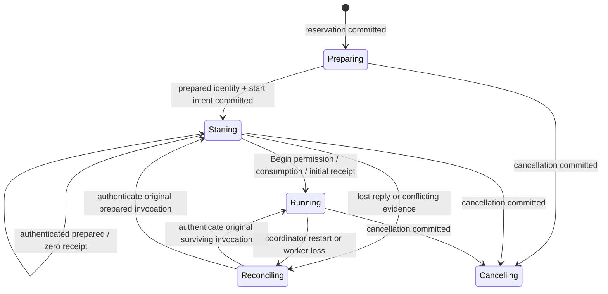

# Worker lifecycle: admission and Begin slice

This is the first reviewable slice of [#34](https://github.com/aortez/playtime/issues/34),
based on merged main `a8a3dab9b5824d19b778c1ac597d6bd609eb0806`.
It provides a durable admission ledger, private worker control and an explicitly
synthetic subprocess fixture. It does **not** finish #34 or enable unattended
experimental execution.

## Ownership and the HTTP branch

`playtime-server::lifecycle` owns admission, orchestration and its ledger.
`playtime-worker-control` owns framing, credentials, bootstrap checks and the
prepared worker's one-use grant. It has no server, HTTP, SQLite, engine or storage
dependency. `playtime-protocol::worker` owns private version-1 messages, separately
from #35's HTTP DTOs. The current worker kind is `supervision_fixture`; a real
worker is not advertised by this milestone.

#46's application interface was inspected at `e2fa960f2cb9f5add6debe8fd147cbf9da527392`,
then its integration with #45 at `c3ca5018d677f4b219eebe104f73ede5648361c8`.
Lifecycle files, `tests/lifecycle.rs` and `examples/lifecycle_fixture.rs` are owned
here; HTTP/auth/client files stay with #46. Tokio 1.53.3, async-trait 0.1.92,
getrandom 0.4.3 and subtle 2.6.1 match that committed branch. Merge the additive
workspace/member dependencies, both `playtime-server` manifests and both library
exports when integrating; retain every HTTP module and add `pub mod lifecycle`.
No changes from another checkout's working tree are imported.

The later #20 adapter maps `AdmissionRequest` to the API's typed
recipe/mode/preview request. Its durable service identifier can be represented by
the HTTP `ServiceId` without changing that contract. It must retain replay-before-
preview semantics and distinguish acceptance from running. There is deliberately
no HTTP `Application` implementation in this slice.

## Durable transitions

The SQLite ledger lives at `.playtime/service.sqlite3`, with verified WAL,
`synchronous=FULL`, foreign keys and schema version 1. Its service identity is
created once and cross-checked against a private identity file. Missing, damaged,
incomplete or unsupported ledgers fail closed; they are never silently rebuilt.
The identity file cannot reconstruct missing idempotency history.

The separate `service.lock` protects the coordinator. A unique active column
reserves one run, including uncertain and cancelling runs. The ledger stores the
canonical typed request and its digest, frozen worker selection and allocation,
accepted time, prepared identity, start intent, Begin permission, cancellation
intent and last authenticated worker status. There are at most 16 admitted
blocking ledger operations; short transactions do not cross archive or process
operations. Once a coordinator operation is accepted, it belongs to a detached
Tokio task, so dropping a caller does not roll back or abandon its commit.



1. Lookup the key before checking today's preview or busy state. A matching
   typed request returns its original selection and run; a different request
   conflicts. A different service identity is rejected first.
2. Under the Python-compatible run lock, validate/freeze the selection and save
   the reservation. Acceptance means that reservation exists, not that work ran.
3. Prepare immutable fixture inputs and a private executable copy. Save the exact
   preparation and a single start intent before submitting the absolute executable
   with typed arguments. An ambiguous submission is queried, never resubmitted.
4. Release the launcher's run lock after submission, before waiting for prepared.
   The worker acquires that same lock and its prepared writer lock, verifies the
   reservation, actual `/proc/self/exe` image and frozen input identity, and reports
   prepared. It holds both locks while waiting for Begin. No fixture execution
   record exists at this point.
5. Commit Begin permission, publish the immutable private authorization, then send
   Begin. The worker serializes grant operations, durably records consumption,
   starts its original work clock, and publishes its first synthetic receipt.
   Only the resulting authenticated response can establish running.
6. Persist a verified response before returning it to a caller. A lost reply
   leaves the saved frontier unchanged until fresh Status verifies the same
   invocation and bytes. Duplicate Begin on the surviving worker returns its
   existing status; a replacement process refuses a consumed or revoked grant.

Cancellation records the first intent before revocation/notification. Cancellation
before Begin prevents consumption and initial publication, including a delayed
Begin. Cancellation is idempotent and preserves its original time. It does not
prove process termination or release the active slot in this slice.

A new coordinator marks active ownership reconciling before any public liveness
claim. It can reattach to the **same surviving worker**; it never starts a
replacement from a lost reply or worker death. Further experiment execution after
worker loss requires explicit continuation. #43 interface refinement can proceed
alongside this work; its implementation is not a prerequisite for the fixture.

## Private messages and evidence

Messages use a four-byte big-endian length followed by JSON, capped at 64 KiB.
The complete connection/request/reply exchange has a five-second deadline.
Each request gets a fresh 128-bit nonce. Status echoes it and binds service, run,
manifest digest, frozen executable digest, grant, worker, supervisor invocation,
host boot identity and unit. Commands are `status`, `begin` and `cancel`.

Credentials are carried separately from the request body and are redacted from
Debug output. Private directories/files use 0700/0600. Clients validate kernel
peer UID/PID against the independently located supervisor invocation, credentials
authenticate callers, and both sides check the complete binding. A nonce or
self-reported identity alone is insufficient. The fixture supervisor additionally
checks the boot ID, process start ticks and actual executing image; its persisted
record is explicitly fixture evidence, not systemd authority.

Status distinguishes `prepared`, `running`, `cancelled_before_begin`, `cancelling`
and `reconciling`; it separately carries an optional compact returned receipt,
publication-pending flag, frozen wall allocation and original work-clock start.
A prepared zero-prefix receipt cannot establish running. Bodies and event pages
never travel on this control channel. The fake archive port verifies exact prefix
bytes and refuses shorter or conflicting confirmations.

The fixture uses `.playtime/workers/<run>/fixture.evidence`, clearly labeled
synthetic data, **not** another experimental archive format. Compatible
`active.json`/`job.json` pointers name the reserved unit and use Python's
timestamp-eight-hex run IDs; no Python manifest is fabricated. The legacy handoff
test pauses the child before it acquires the run lock, then calls the pinned
Python `ensure_idle` against an explicitly activating fixture unit.

## Run and verify

Use a **new, short temporary root** (Unix socket path length is checked):

```sh
cargo run --locked -p playtime-server --example lifecycle_fixture -- --root /tmp/pt-lifecycle-demo
cargo test --locked -p playtime-server --test lifecycle
cargo test --locked -p playtime-worker-control
```

The walkthrough launches a copied native fixture executable, observes prepared
and running, restarts the coordinator, authenticates the same PID, cancels and
prints its durable trace. It cleans up its own child and preserves the fixture
records. It requires no model, Docker, GPU or user systemd. The private fixture
root must already be private when reused; migration of a legacy root is not
provided here.

Tests cover matching/conflicting keys and service identities, changed defaults,
competing admission, lost start and Begin replies, duplicate Begin, cancellation
before Begin, wrong peer/credential/invocation/nonce, frame bounds, changed worker
images, damaged/deleted ledgers, legacy exclusion, and a **killed coordinator with
a surviving real worker process**. Subprocess helper test entries are ignored when
listed directly and explicitly invoked by their parent tests.

Validation for this slice: workspace formatting and locked Clippy passed;
139 Rust tests passed (six ignored subprocess entries are invoked by their parent
tests), and the Python suite passed 88 tests with six Docker checks skipped.
The final lifecycle/control edits also passed their focused 12-test suite.
The walkthrough above completed with the same worker across coordinator restart.
A temporary export of #46 at `c3ca5018d677f4b219eebe104f73ede5648361c8`, with
the additive manifest/module union described above, passed
`cargo check --workspace --all-targets`. This establishes compile compatibility,
not the real HTTP/worker/archive integration owned by #20.

## Remaining #34 work

- Replace the initial single-operation coordinator gate with independent bounded
  start/cancel control and coalesced confirmation refresh (250 ms floor and bounded
  backoff). Do not let slow archive verification block cancellation.
- Add systemd user-service supervision, independent startup/wall/stop bounds,
  persisted exit/stop diagnostics, cancellation enforcement states and the opt-in
  systemd walkthrough. Current fixture timers are not proof of systemd enforcement.
- Extend fault injection across every ledger/port acknowledgment boundary and
  cover delayed status after takeover and incomplete publication ownership.
- Pin the ownership-generation/recovery guard, persisted recovery attempts and
  explicit abandon-incomplete port with #43. Releasing admission requires proven
  worker/resource termination and the reviewed recovery transaction.
- #20 joins these ports to the real prepared runner handle and authenticated
  returned receipts, production bundles and #46's handlers/client. The real
  worker's source/lock/protocol binding and production packaging remain there.

SQLite durability settings follow its [synchronization documentation](https://www.sqlite.org/pragma.html#pragma_synchronous).
Process-kill tests establish the implemented protocol's behavior, not arbitrary
hardware power-loss guarantees.
