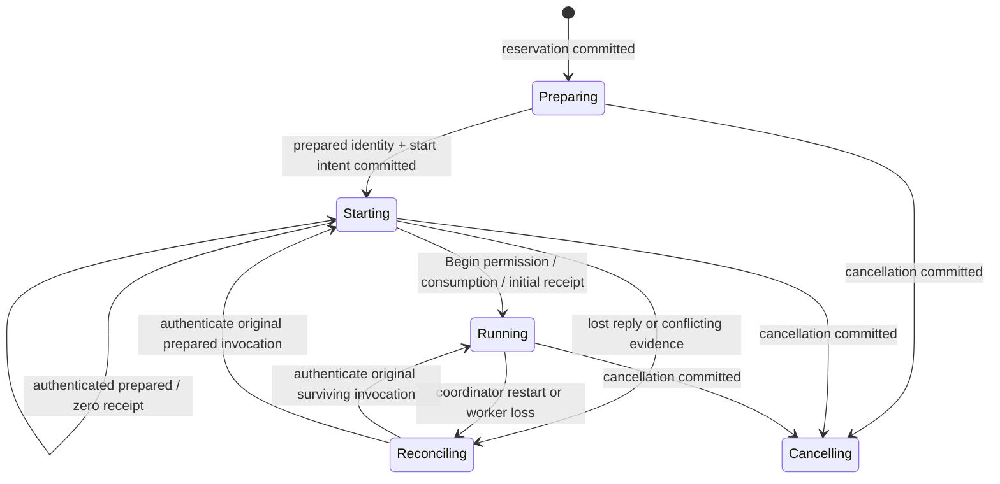

# Worker lifecycle: admission, control and systemd supervision

The admission/control and real systemd supervision slices of
[#34](https://github.com/aortez/playtime/issues/34) are based on merged main
`b81db2a7aa4d38e702627ee78cceff2f171ca225`. They provide durable admission,
private worker control, independent cancellation, confirmed reads and a Linux
user-manager adapter. Execution in the conformance harness is still explicitly
synthetic. Recovery ownership and production integration remain in #34/#43/#20.

## Ownership and the HTTP branch

`playtime-server::lifecycle` owns admission, orchestration and its ledger.
`playtime-worker-control` owns framing, credentials, bootstrap checks and the
prepared worker's one-use grant. It has no server, HTTP, SQLite, engine or storage
dependency. `playtime-protocol::worker` owns private version-1 messages, separately
from #35's HTTP DTOs. The current worker kind is `supervision_fixture`; a real
worker is not advertised by this milestone.

#46's application interface was inspected at `e2fa960f2cb9f5add6debe8fd147cbf9da527392`,
then its integration with #45 and CI adjustment at
`e834fadb50b1df9094456ae139a7a10f5d746381`.
The #46 integration includes the lifecycle foundation merged by #48 at
`22282e72bbfb0d215ab890edad7d6e0a5a608a0a`. Lifecycle files,
`tests/lifecycle.rs`, `tests/lifecycle/` and `examples/lifecycle_fixture.rs`
remain separate from the HTTP/auth/client implementation. The combined workspace
retains both sets of pinned dependencies and exports every HTTP module alongside
`pub mod lifecycle`. No changes from another checkout's working tree are imported.

The later #20 adapter maps `AdmissionRequest` to the API's typed
recipe/mode/preview request. Its durable service identifier can be represented by
the HTTP `ServiceId` without changing that contract. It must retain replay-before-
preview semantics and distinguish acceptance from running. There is deliberately
no HTTP `Application` implementation in this slice.

## Durable transitions

The SQLite ledger lives at `.playtime/service.sqlite3`, with verified WAL,
`synchronous=FULL`, foreign keys and schema version 3. Versions 1 and 2 upgrade
in one transaction, preserving service identity, canonical requests and counters.
Version 1 adds ownership/revision counters; version 2 must already contain them.
Version 3 adds supervisor observations and stop acceptance/delivery separately
from private-control cancellation. Migration never defaults damaged v2 counters.
Older binaries refuse the upgraded schema. Its service identity is
created once and cross-checked against a private identity file. Missing, damaged,
incomplete or unsupported ledgers fail closed; they are never silently rebuilt.
The identity file cannot reconstruct missing idempotency history.

The separate `service.lock` protects the coordinator. A unique active column
reserves one run, including uncertain and cancelling runs. Lock guard drop explicitly
unlocks its file description before close: a descriptor temporarily inherited by
a concurrent process spawn must not prolong the guard's ownership lifetime. The ledger stores the
canonical typed request and its digest, frozen worker selection and allocation,
accepted time, prepared identity, start intent, Begin permission, cancellation
intent, delivery acknowledgment and last verified worker status. There are at most
16 admitted blocking ledger operations; short transactions do not cross archive or process
operations. Once a coordinator operation is accepted, it belongs to a detached
Tokio task, so dropping a caller does not roll back or abandon its commit.



1. Validate the service/request and look up the key before acquiring launch
   control or checking today's preview or busy state. Accepted retries remain
   available while preparation or Begin owns launch control. Recheck the key
   when acquiring that control, including a busy result racing another commit.
   A matching typed request returns its original selection and run; a different request
   conflicts. A different service identity is rejected first.
2. Under the Python-compatible run lock, validate/freeze the selection and save
   the reservation. Acceptance means that reservation exists, not that work ran.
3. Prepare immutable fixture inputs and a private executable copy. Save the exact
   preparation and a single start intent before submitting the absolute executable
   with typed arguments. An ambiguous submission is queried, never resubmitted.
4. Release the launcher's run lock after submission, before waiting for prepared.
   The worker acquires that same lock and its prepared writer lock, verifies the
   reservation, actual `/proc/self/exe` image and frozen input identity, and reports
   prepared. It holds both locks while waiting for Begin. No fixture execution
   record exists at this point.
5. Commit Begin permission, publish the immutable private authorization, then send
   Begin. The worker serializes grant operations, durably records consumption,
   starts its original work clock, and publishes its first synthetic receipt.
   Only the resulting authenticated response can establish running.
6. Persist a verified response before returning it to a caller. A lost reply
   leaves the saved frontier unchanged until fresh Status verifies the same
   invocation and bytes. Duplicate Begin on the surviving worker returns its
   existing status; a replacement process refuses a consumed or revoked grant.

Cancellation records the first intent before revocation/notification and preserves
its original time. Revocation prevents later Begin consumption, including a
request still waiting on coordinator preflight. Cancellation racing an already
dispatched Begin cannot undo work that has consumed its grant. If preparation
finishes after cancellation, its identity is retained for cleanup, its grant is
revoked and no worker is submitted. Cancellation does not prove process termination
or release the active slot in these slices.

## Independent control and confirmations

Launch operations, cancellation and status refresh use separate bounded paths.
Status callers share one operation per run, including archive verification.
A completed refresh has a 250 ms minimum cooldown; failures back off exponentially
to at most five seconds. Calls during cooldown read the saved ledger without
creating another task or timer. Dropping all observers leaves the operation owned
by the coordinator. Registries retain at most 16 runs, with 64 status observers
and 16 cancellation observers; excess observers receive busy.

Status, Begin and Cancel each have a separate one-operation transport lane.
Supervisor lookup, private bootstrap reads and the socket exchange share a
five-second deadline. A preflight still blocked after its deadline retains its
lane until it settles, so retries cannot accumulate abandoned I/O. It rechecks
the deadline and saved ownership before sending. The fixture accepts at most
eight concurrent connections, allowing cancellation alongside an incomplete frame.
Worker ownership waits share that same request deadline, so brief Status or timer
contention does not reject a control command. Once queued on the blocking pool,
an operation retains ownership and rechecks its deadline before executing; an
expired queued command cannot run later when the pool becomes available.

Archive verification runs outside ledger transactions and cancellation. Both
successful confirmations and failures condition their commit on the saved record
revision and ownership generation. A cancellation or generation change during
verification makes the candidate stale. Shorter receipts, conflicting equal
receipts, invalid prefix extensions and changed work clocks preserve the previous
confirmed evidence. Equal confirmations still verify bytes; an unchanged record
adds no revision or trace entry.

`cancel_delivery` distinguishes `requested`, `worker_acknowledged` and `uncertain`.
An authenticated Cancel acknowledgment updates only delivery state, without
waiting for archive validation. It cannot advance `last_status` or its receipt.
Consequently, the saved worker status can still say running after cancellation
was acknowledged; a later verified Status refresh supplies new archive evidence.
These delivery states do not establish supervisor stop acceptance or termination.
The generation check is a commit fence; exclusive recovery ownership and its
authority to increment that generation remain part of the later recovery slice.

A new coordinator marks active ownership reconciling before any public liveness
claim. It can reattach to the **same surviving worker**; it never starts a
replacement from a lost reply or worker death. Further experiment execution after
worker loss requires explicit continuation. #43 interface refinement can proceed
alongside this work; its implementation is not a prerequisite for the fixture.

## Private messages and evidence

Messages use a four-byte big-endian length followed by JSON, capped at 64 KiB.
The complete connection/request/reply exchange has a five-second deadline.
Each request gets a fresh 128-bit nonce. Status echoes it and binds service, run,
manifest digest, frozen executable digest, grant, worker, supervisor invocation,
host boot identity and unit. Commands are `status`, `begin` and `cancel`.

Credentials are carried separately from the request body and are redacted from
Debug output. Private directories/files use 0700/0600. Clients validate kernel
peer UID/PID against the independently located supervisor invocation, credentials
authenticate callers, and both sides check the complete binding. A nonce or
self-reported identity alone is insufficient. The fixture supervisor additionally
checks the boot ID, process start ticks and actual executing image; its persisted
record is explicitly fixture evidence, not systemd authority.

Private file reads and grant durability reconfirmation use nonblocking,
no-follow opens followed by descriptor type, ownership, link-count and mode
checks. A FIFO cannot block open before these checks run. Directory syncs require
directory descriptors. Invalid revocation evidence preserves the cancellation
intent and active reservation while reporting delivery uncertainty.

Development and test builds optimize the SHA-256 dependency. The fixture hashes
the actual executing image during supervisor lookup, including large debug test
executables; unoptimized hashing under CPU contention can exhaust the five-second
control deadline before a request is sent. The deadline and image checks remain
unchanged. Fixtures explicitly wait out the refresh cooldown when asserting a
fresh probe after worker termination or joining concurrent observers. This avoids
mistaking cached state for a new probe or saturating the bounded ledger with
independent cached-status reads.
Restart fixtures likewise wait for actual service-lock availability after
dropping a coordinator; owned operations retain exclusion until they settle.

Status distinguishes `prepared`, `running`, `cancelled_before_begin`, `cancelling`
and `reconciling`; it separately carries an optional compact returned receipt,
publication-pending flag, frozen wall allocation and original work-clock start.
A prepared zero-prefix receipt cannot establish running. Bodies and event pages
never travel on this control channel. The fake archive port verifies exact prefix
bytes and refuses shorter or conflicting confirmations.

The fixture uses `.playtime/workers/<run>/fixture.evidence`, clearly labeled
synthetic data, **not** another experimental archive format. Compatible
`active.json`/`job.json` pointers name the reserved unit and use Python's
timestamp-eight-hex run IDs; no Python manifest is fabricated. The legacy handoff
test pauses the child before it acquires the run lock, then calls the pinned
Python `ensure_idle` against an explicitly activating fixture unit.

## Run and verify

Use a **new, short temporary root** (Unix socket path length is checked):

```sh
cargo run --locked -p playtime-server --example lifecycle_fixture -- --root /tmp/pt-lifecycle-demo
cargo test --locked -p playtime-server --test lifecycle
cargo test --locked -p playtime-worker-control
```

The walkthrough launches a copied native fixture executable, observes prepared
and running, restarts the coordinator, authenticates the same PID, cancels and
prints its durable trace and separate cancellation delivery state. Its saved
worker status describes the last verified confirmation before cancellation.
It cleans up its own child and preserves the fixture records. It requires no
model, Docker, GPU or user systemd. The private fixture
root must already be private when reused; migration of a legacy root is not
provided here.

Tests cover matching/conflicting keys and service identities, changed defaults,
competing admission, lost start and Begin replies, duplicate Begin, cancellation
before Begin, wrong peer/credential/invocation/nonce, frame bounds, changed worker
images, damaged/deleted ledgers, legacy exclusion, and a **killed coordinator with
a surviving real worker process**. Subprocess helper test entries are ignored when
listed directly and explicitly invoked by their parent tests.

Coordination tests also block preparation, Begin preflight, archive verification
and supervisor lookup while cancelling; coalesce concurrent observers; retain
timed-out preflight ownership; reject stale generation results and invalid receipt
extensions; avoid duplicate confirmation history; and exercise schema migration
and damaged revision fields. A virtual-clock test verifies the refresh floor,
backoff cap and continued ownership after observers disappear.

Review regressions hold preparation open while replaying accepted requests and
checking conflicts, and use bounded subprocesses to exercise FIFO rejection during
cancellation and file reconfirmation. They also reject links, directories and
non-private file modes without replacing the invalid evidence.

## Real systemd supervision

`SystemdSupervisor::connect()` requires a user systemd manager >=250 and cgroup
v2. It never falls back to subprocess supervision. `StartTransientUnit` receives
typed `ExecStartEx`/`ExecStopPostEx` arguments with `no-env-expand`; `$`, percent
specifiers, whitespace and shell punctuation remain literal. No Cargo, shell or
mutable executable pointer is involved. The start port returns `Ok(None)` for
accepted submission before a peer PID is available. The coordinator releases its
run lock before waiting for preparation. Lost replies retain the one start intent.

The unit name is `playtime-<launch invocation nonce>.service`, and compatibility
job metadata names that actual unit. The existing wire binding carries this
preallocated launch identity. systemd assigns its own invocation ID at start;
the worker durably binds that ID, PID/start ticks and cgroup to the frozen bootstrap.
Reattachment checks both identities, current manager properties, executing image,
boot, process identity, cgroup and authenticated socket peer. Missing/conflicting
observations fail closed. Unit names are never reused by the coordinator.

The pinned D-Bus dependency uses the same `async-io` backend as the workbench's
AccessKit dependency. Lifecycle orchestration still uses Tokio. Enabling
`zbus/tokio` here would unify features across the workspace and silently change
AccessKit's D-Bus runtime; avoid that cross-workspace behavior change.

The adapter sets `Type=notify`, `NotifyAccess=main`, `Restart=no`, `UMask=0077`,
`KillMode=mixed`, `SendSIGKILL=yes` and `TimeoutStopSec=180s`. Startup uses the
remaining original startup allocation, at most 60 seconds; submission never
extends the prepared deadline. `RuntimeMaxSec` uses the frozen wall allocation
and starts at READY. Effective enforcement properties are checked on observation.
The worker notification API sends only READY, never timeout extensions. D-Bus
operations have five-second bounds; timed-out filesystem work retains one of four
supervisor I/O permits until it settles.

Worker integration for #20:

1. At the frozen worker's entry point, call
   `systemd::record_exit_if_requested(bootstrap_path)` before acquiring exclusion.
   A true result means ExecStopPost saved systemd's exit diagnostics; exit then.
2. Verify the bootstrap/actual executable and hold the same prepared writer and
   run lock. For `PLAYTIME_SYSTEMD_WORKER=1`, attach `systemd::Notify` and pass it
   to `Worker::with_systemd`. Grant consumption and the initial returned receipt
   precede READY; failed publication and duplicate Begin never emit another READY.
3. Handle SIGTERM independently in the production controller. Preserve its first
   stop decision and original clock, distinguishing wall expiry from explicit
   cancellation. The fixture's signal marker is not controller policy.

ExecStopPost runs the same immutable executable/argv and saves manager-provided
`SERVICE_RESULT`, `EXIT_CODE` and `EXIT_STATUS` in a private operational file. It
can run after the API has died. These records are not archive evidence. Missing
or conflicting diagnostics remain uncertain. Stop-post publication itself is
bounded by systemd's stop timeout; admission remains reserved until the entire
unit cgroup has gone, including that helper.

Cancellation first persists intent, revokes the grant and attempts private
notification, then requests the original unit's stop. The ledger distinguishes
requested, supervisor-accepted, stopped and uncertain enforcement. A private
Cancel acknowledgment is still separate. Accepted jobs are queried on retries;
a lost acknowledgment is recovered from the existing deactivating unit. The
original manager stop timestamp is retained when later observations lose it.
`stop_accepted` records when acceptance was first observed, not a new grace clock.
Stop submission uses the ledger's previously authenticated invocation plus fresh
manager unit, invocation, cgroup and policy checks. It does not reread private
bootstrap/identity/exit files or acquire a supervisor filesystem permit. Without
a saved identity, initial authentication must succeed before a stop can be sent.
Manager acceptance is persisted before querying termination diagnostics; failed
diagnostic reads leave reconciliation uncertain without downgrading an accepted
stop or restarting its grace. The independent stop remains effective even if
ExecStopPost cannot publish its diagnostic.
Stopped means an inactive/failed/unloaded matching invocation and empty cgroup.
It does **not** establish external-resource cleanup or grant recovery authority.

```sh
cargo run --locked -p playtime-server --example lifecycle_fixture -- --root /tmp/pt-systemd-demo --systemd
cargo test --locked -p playtime-server --test lifecycle systemd_live -- --ignored --nocapture
```

The opt-in tests use unique units and private roots; they exercise the actual
60-second startup bound, frozen wall timer, 180-second ignored-stop grace,
descendant cleanup, cancellation before Begin, literal arguments, wrong invocation
rejection, cancellation with corrupt private exit/identity/bootstrap files, and
reattachment after killing the coordinator. They require no model,
Docker or GPU. Tests clean only their own units. On failure they request stop and
retain the frozen files for the independently bounded service's exit hook.

Default tests cover lost stop replies, manager outages, stable acceptance/grace
across coordinator restart and diagnostic failures, retained admission after
worker termination, v1/v2 ledger migration, and READY ordering around initial
publication. They do not
substitute for the opt-in manager tests. The private wire protocol stays v1;
HTTP DTOs and archive formats are unchanged by this slice.

See systemd's [D-Bus interface](https://www.freedesktop.org/software/systemd/man/latest/org.freedesktop.systemd1.html),
[service timeout semantics](https://www.freedesktop.org/software/systemd/man/latest/systemd.service.html),
and [notification contract](https://www.freedesktop.org/software/systemd/man/latest/sd_notify.html).

Validation for this slice: formatting and locked workspace Clippy passed;
258 Rust tests passed, with 14 opt-in/helper entries ignored in the default run.
All six opt-in systemd tests passed against user systemd 259.5, including the
full 60/180-second bounds. The Python suite ran 94 tests: 88 passed and six Docker
checks were skipped. Native and systemd walkthroughs completed. The inherited
file-description regression failed before the explicit-unlock fix and passed
afterward. Corrupt private diagnostics reproduced blocked cancellation before the
manager-only stop fix. Fixture spawning also retries explicit pre-exec `ETXTBSY`
rejections for at most five seconds within the original startup deadline; it does
not retry ambiguous starts. A held-writer regression verifies both retry and expiry.
PR #51's shared `Worker` status-refresh additions were reviewed as
additive; production integration still must install the systemd entry/notify hooks.

## Remaining #34 work

- Extend fault injection across every ledger/port acknowledgment boundary and
  cover real exclusive takeover and incomplete publication ownership.
- Implement #43's proposed owned `InvocationFence`, `HeldRecoveryAuthority`,
  stable recovery attempt and explicit resolution ports against #50's compiled
  DTO/JSONL contract once reviewed. A serializable stopped observation is not
  that fence. Releasing admission additionally requires proven resource cleanup
  and the reviewed recovery transaction.
- #20 joins these ports to the real prepared runner handle and authenticated
  returned receipts, production bundles and #46's handlers/client. The real
  worker's source/lock/protocol binding and production packaging remain there.

SQLite durability settings follow its [synchronization documentation](https://www.sqlite.org/pragma.html#pragma_synchronous).
Process-kill tests establish the implemented protocol's behavior, not arbitrary
hardware power-loss guarantees.
